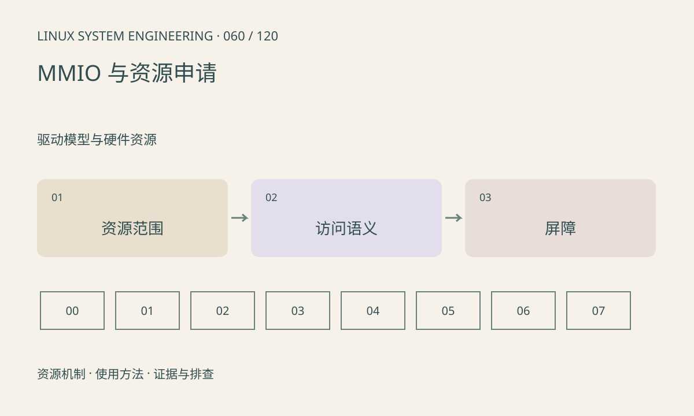

> 第 60 / 120 课 · 驱动模型与硬件资源。返回[课程合集](/series/embedded-linux-system-engineering/)。

## 机制与资源关系

寄存器不是普通 RAM，读取可能清状态，写入可能触发操作。驱动应通过资源管理、映射和体系结构访问接口操作 MMIO，不能靠 volatile 指针替代全部屏障和访问规则。



## 实际用法与观察入口

以下是操作说明；先确认执行环境、工具帮助和目标对象。设备名、PID、地址及项目名示例需要按实际替换，不能将整段命令当通用板端脚本执行。

```sh
cat /proc/iomem
ls /sys/bus/platform/devices
```

## 输出解读与排查顺序

地址被隐藏为零可能是权限策略，不表示设备没有资源。用户态 devmem 绕过驱动所有权，可能与电源管理和中断并发冲突；本文不提供盲写寄存器步骤。

### 情境推演

寄存器读后清零时，调试代码额外读取一次就可能改变业务。排障应先确认读取副作用，再决定是否允许加入日志；所谓“只读寄存器检查”也不总是无副作用。

## 练习与参考分析

对 W1C 状态寄存器解释为何读改写可能清掉额外状态。参考结论：先查读写语义和所属驱动，再设计受控访问，不把普通内存操作套给寄存器。

本课练习属于阅读、分析或板端观察。未在目标开发板执行，记录时应写明板型、内核配置、工具版本和原始输出。

## 官方资料与版本边界

- [本课参考资料](https://docs.kernel.org/driver-api/device-io.html)

内核、工具和厂商 BSP 的支持范围需分别核对。参考资料可能对应较新版本；不要据此推定旧 BSP 支持所有接口。

[上一课：模块、固件加载与版本匹配](/posts/linux-sys-059.html) · [下一课：IRQ、软中断与工作队列](/posts/linux-sys-061.html)
