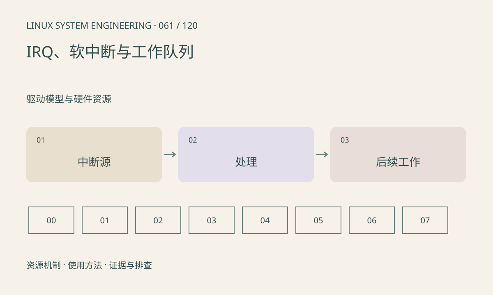

> 第 61 / 120 课 · 驱动模型与硬件资源。返回[课程合集](/series/embedded-linux-system-engineering/)。

## 机制与资源关系

硬中断处理必须快速并遵守上下文限制，线程化中断和 workqueue 可把部分工作移到可调度上下文。softirq 也有自己的执行约束；看到 ksoftirqd 不等于所有软中断都只在该线程执行。



## 实际用法与观察入口

以下是操作说明；先确认执行环境、工具帮助和目标对象。设备名、PID、地址及项目名示例需要按实际替换，不能将整段命令当通用板端脚本执行。

```sh
cat /proc/interrupts
cat /proc/softirqs
cat /proc/stat
```

## 输出解读与排查顺序

间隔采样看增量并关联业务操作。IRQ 不增长可能是外设未产生、中断被屏蔽或路由错误；持续狂增可能是未清源或电平条件一直存在。每帧不一定恰好一个中断。

### 情境推演

IRQ 计数每秒上百万而业务无帧，可能是电平源未清或状态一直有效。先查驱动处理与硬件条件；屏蔽中断只停止症状，也可能让等待任务永远无法完成。

## 练习与参考分析

记录空闲和取流两阶段的中断差值。参考结论：中断计数证明某条通知发生，不证明 DMA 缓冲内容正确或应用已消费。

本课练习属于阅读、分析或板端观察。未在目标开发板执行，记录时应写明板型、内核配置、工具版本和原始输出。

## 官方资料与版本边界

- [本课参考资料](https://docs.kernel.org/core-api/genericirq.html)

内核、工具和厂商 BSP 的支持范围需分别核对。参考资料可能对应较新版本；不要据此推定旧 BSP 支持所有接口。

[上一课：MMIO 与资源申请](/posts/linux-sys-060.html) · [下一课：GPIO、pinctrl 与有效电平](/posts/linux-sys-062.html)
