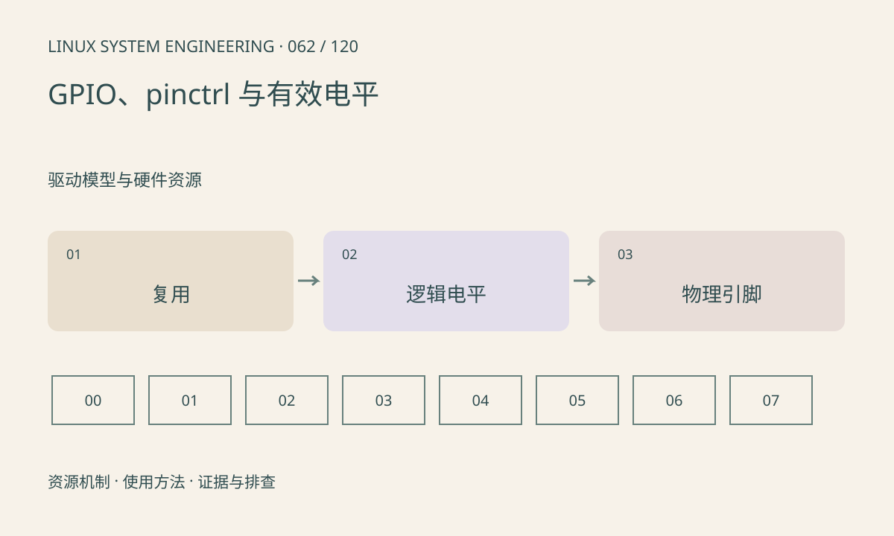

> 第 62 / 120 课 · 驱动模型与硬件资源。返回[课程合集](/series/embedded-linux-system-engineering/)。

## 机制与资源关系

pinctrl 决定引脚复用和电气配置，GPIO 描述逻辑线。active-low 把逻辑有效与物理高低分开；驱动请求的逻辑 1 可能对应物理低电平。线偏移也不一定等于原理图球号。



## 实际用法与观察入口

以下是操作说明；先确认执行环境、工具帮助和目标对象。设备名、PID、地址及项目名示例需要按实际替换，不能将整段命令当通用板端脚本执行。

```sh
ls /dev/gpiochip*
# 安装了 libgpiod 工具时先确认版本和参数
gpioinfo --help
gpioinfo
```

## 输出解读与排查顺序

先查芯片、line、consumer 和复用状态。旧 sysfs GPIO 接口已弃用但旧 BSP 仍可能依赖它；不能混用两套编号。不要抢占已被内核驱动使用的复位或电源线。

### 情境推演

DTS 声明 reset 为 active-low，驱动请求逻辑有效时引脚可能变低。若再在驱动手工反相就会双重反转。逻辑语义与物理电压应各写一列核对。

## 练习与参考分析

建立球号→pinmux→gpiochip/offset→逻辑有效电平表。参考结论：软件读到的逻辑值和示波器电压需通过 active-low 及输入输出配置解释。

本课练习属于阅读、分析或板端观察。未在目标开发板执行，记录时应写明板型、内核配置、工具版本和原始输出。

## 官方资料与版本边界

- [本课参考资料](https://docs.kernel.org/userspace-api/gpio/chardev.html)

内核、工具和厂商 BSP 的支持范围需分别核对。参考资料可能对应较新版本；不要据此推定旧 BSP 支持所有接口。

[上一课：IRQ、软中断与工作队列](/posts/linux-sys-061.html) · [下一课：clock、reset、regulator 与生命周期](/posts/linux-sys-063.html)
