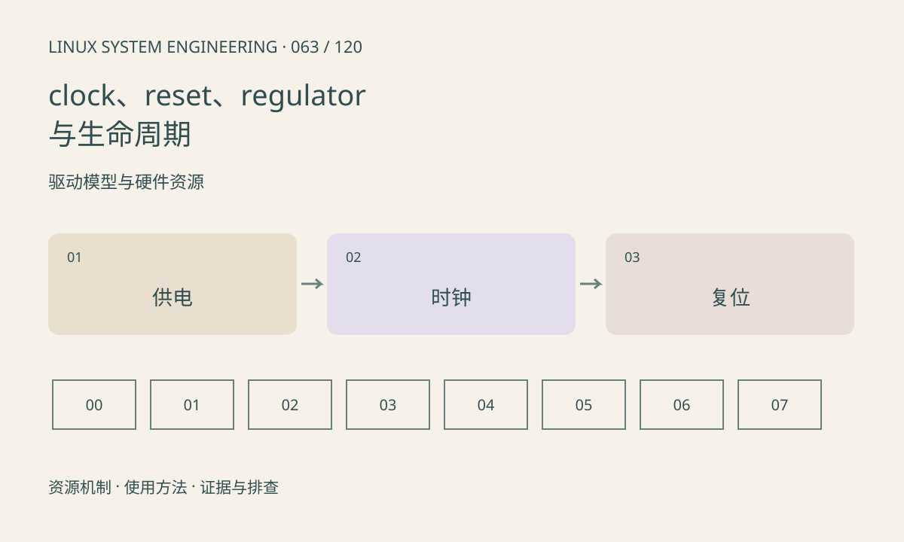

> 第 63 / 120 课 · 驱动模型与硬件资源。返回[课程合集](/series/embedded-linux-system-engineering/)。

## 机制与资源关系

外设通常需要供电、时钟和复位顺序。获取资源句柄不等于使能，多个消费者共享资源时引用计数也影响关闭行为。runtime PM 可能在空闲时撤销运行条件。



## 实际用法与观察入口

以下是操作说明；先确认执行环境、工具帮助和目标对象。设备名、PID、地址及项目名示例需要按实际替换，不能将整段命令当通用板端脚本执行。

```sh
# 已挂载且接口存在时，只读查看
cat /sys/kernel/debug/clk/clk_summary
cat /sys/kernel/debug/regulator/regulator_summary
dmesg
```

## 输出解读与排查顺序

日志里 probe 成功后访问超时，应检查运行时状态和资源顺序。时钟请求频率不一定等于实际频率。异常路径必须撤销已完成的步骤，不能只写正常 remove 路径。

### 情境推演

probe 首次工作、空闲后再次访问超时，优先检查 runtime PM 是否恢复时钟与电源，以及使用计数是否平衡。重复初始化全部寄存器未必能补齐资源条件。

## 练习与参考分析

画供电→时钟→释放复位→访问寄存器的依赖，以及失败时的回滚。参考结论：顺序按芯片手册确定，不能把此通用示意当所有芯片的固定时序。

本课练习属于阅读、分析或板端观察。未在目标开发板执行，记录时应写明板型、内核配置、工具版本和原始输出。

## 官方资料与版本边界

- [本课参考资料](https://docs.kernel.org/driver-api/clk.html)

内核、工具和厂商 BSP 的支持范围需分别核对。参考资料可能对应较新版本；不要据此推定旧 BSP 支持所有接口。

[上一课：GPIO、pinctrl 与有效电平](/posts/linux-sys-062.html) · [下一课：DMA、IOMMU 与缓存所有权](/posts/linux-sys-064.html)
