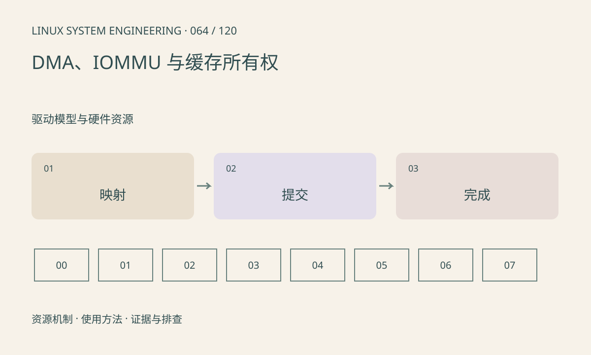

> 第 64 / 120 课 · 驱动模型与硬件资源。返回[课程合集](/series/embedded-linux-system-engineering/)。

## 机制与资源关系

CPU 虚拟地址、物理地址和 DMA 地址是不同概念。DMA API 按平台完成映射及同步，IOMMU 可建立设备地址空间。coherent 内存也不取消描述符发布顺序和缓冲所有权要求。



## 实际用法与观察入口

以下是操作说明；先确认执行环境、工具帮助和目标对象。设备名、PID、地址及项目名示例需要按实际替换，不能将整段命令当通用板端脚本执行。

```sh
ls /sys/kernel/iommu_groups
cat /proc/meminfo
dmesg
```

## 输出解读与排查顺序

记录 map、submit、complete、sync、unmap 和释放的时序。IOMMU fault 应保留设备、地址和访问类型；不能简单关闭 IOMMU 掩盖越界。用户态模型只验证协议，不执行真实缓存维护。

### 情境推演

DMA 输出 buffer 在任务未完成时被 CPU 读，得到旧帧或半帧。需等待设备完成并按平台执行同步，再转交消费者；单纯 sleep 一个经验时长不能保证完成。

## 练习与参考分析

检查“CPU 提交后继续改输入”和“设备完成前释放输出”两种错误。参考结论：即使没有缓存问题，异步生命周期错误仍能导致随机花屏。

本课练习属于阅读、分析或板端观察。未在目标开发板执行，记录时应写明板型、内核配置、工具版本和原始输出。

## 官方资料与版本边界

- [本课参考资料](https://docs.kernel.org/core-api/dma-api-howto.html)

内核、工具和厂商 BSP 的支持范围需分别核对。参考资料可能对应较新版本；不要据此推定旧 BSP 支持所有接口。

[上一课：clock、reset、regulator 与生命周期](/posts/linux-sys-063.html) · [下一课：UART、termios 与串口使用](/posts/linux-sys-065.html)
