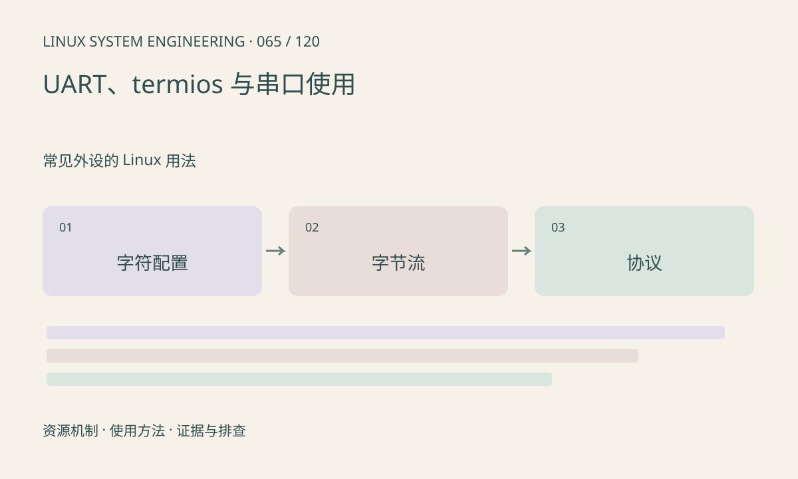

> 第 65 / 120 课 · 常见外设的 Linux 用法。返回[课程合集](/series/embedded-linux-system-engineering/)。

## 机制与资源关系

串口 fd 的行为受 termios 控制，规范模式可能等待换行，回显和字符转换会修改字节流。二进制协议通常需要明确原始模式、波特率、字长、校验、停止位和流控。



## 实际用法与观察入口

以下是操作说明；先确认执行环境、工具帮助和目标对象。设备名、PID、地址及项目名示例需要按实际替换，不能将整段命令当通用板端脚本执行。

```sh
# 替换成已确认的串口；仅查看属性
stty -F /dev/ttyS1 -a
ls -l /dev/ttyS1
```

## 输出解读与排查顺序

先确认端口没被控制台或其他进程占用。VMIN、VTIME 与非阻塞模式的组合影响读取；协议层仍要处理拆包、粘包和校验。发送测试会影响外设，不能对未知设备随意写数据。

### 情境推演

二进制报文含 0x0a 却被转换或等待整行，先检查规范模式和输入输出标志。伪终端可复现这类用户态设置，物理乱码仍需额外检查串口参数与电平。

## 练习与参考分析

用本课伪终端实验验证原始字节收发，无需真实串口。参考结论：PTY 验证 termios 和应用读写，不验证物理波特率、RS-485 方向或电气质量。

### 独立实验包

主机 Linux 的有界 C 实验；不访问真实外设，不代表板端时序或性能。 默认入口、源文件和实际运行记录都在下载包中。

```experiment
practice
```

## 官方资料与版本边界

- [本课参考资料](https://man7.org/linux/man-pages/man3/termios.3.html)

内核、工具和厂商 BSP 的支持范围需分别核对。参考资料可能对应较新版本；不要据此推定旧 BSP 支持所有接口。

[上一课：DMA、IOMMU 与缓存所有权](/posts/linux-sys-064.html) · [下一课：I²C 设备、事务与访问工具](/posts/linux-sys-066.html)
