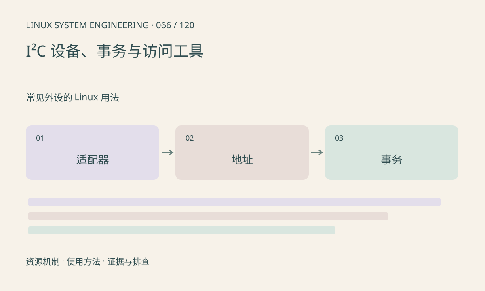

> 第 66 / 120 课 · 常见外设的 Linux 用法。返回[课程合集](/series/embedded-linux-system-engineering/)。

## 机制与资源关系

Linux I²C 适配器编号不一定与芯片手册控制器编号相同。许多寄存器读取需要写寄存器地址后 repeated START 再读，拆成独立 write/read 可能不等价。设备地址还要区分 7 位值和含方向位的表示。



## 实际用法与观察入口

以下是操作说明；先确认执行环境、工具帮助和目标对象。设备名、PID、地址及项目名示例需要按实际替换，不能将整段命令当通用板端脚本执行。

```sh
ls /sys/class/i2c-adapter
ls /sys/bus/i2c/devices
# 安装 i2c-tools 时，仅列适配器
i2cdetect -l
```

## 输出解读与排查顺序

不要默认扫描所有地址安全，扫描会发事务，某些器件可能受影响。已绑定驱动的设备应通过其接口访问，避免强制用户态操作与驱动竞争。

### 情境推演

sensor ID 可读但后续寄存器访问失败，可能涉及页选择、寄存器地址宽度或 repeated START。记录完整事务和器件状态，不能仅因 i2cdetect 显示地址就排除协议问题。

## 练习与参考分析

把手册地址字节 0x6c 换算成 7 位地址 0x36，并画组合读事务。参考结论：读到地址 ACK 不能证明寄存器序列和上电状态正确。

本课练习属于阅读、分析或板端观察。未在目标开发板执行，记录时应写明板型、内核配置、工具版本和原始输出。

## 官方资料与版本边界

- [本课参考资料](https://docs.kernel.org/i2c/dev-interface.html)

内核、工具和厂商 BSP 的支持范围需分别核对。参考资料可能对应较新版本；不要据此推定旧 BSP 支持所有接口。

[上一课：UART、termios 与串口使用](/posts/linux-sys-065.html) · [下一课：SPI、spidev 与传输](/posts/linux-sys-067.html)
