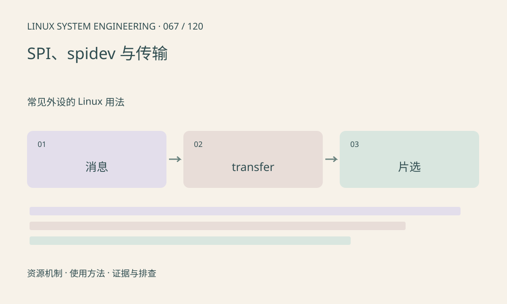

> 第 67 / 120 课 · 常见外设的 Linux 用法。返回[课程合集](/series/embedded-linux-system-engineering/)。

## 机制与资源关系

SPI 传输同时涉及发送和接收，设备协议定义指令、地址、dummy 和数据阶段。片选在多个 transfer 间是否保持由消息组织和控制器能力决定。读写成功仅表示控制器完成事务，不等于从设备认可命令。



## 实际用法与观察入口

以下是操作说明；先确认执行环境、工具帮助和目标对象。设备名、PID、地址及项目名示例需要按实际替换，不能将整段命令当通用板端脚本执行。

```sh
ls /sys/bus/spi/devices
ls /dev/spidev*
```

## 输出解读与排查顺序

检查 mode、字长、最大速率和片选极性，并用波形对照。spidev 节点不是所有 SPI 设备的默认接口；已被专用驱动管理的设备不应强改绑定来绕过协议。

### 情境推演

命令阶段和读取阶段分别发起独立消息，片选中途释放，从设备可能重新解析。将协议要求与驱动 message/transfer 边界对照，再考虑频率和波形问题。

## 练习与参考分析

画一次读 Flash 的命令、地址和 dummy 阶段。参考结论：CPOL/CPHA 正确仍可能因片选提前释放而失败，需检查完整消息边界。

本课练习属于阅读、分析或板端观察。未在目标开发板执行，记录时应写明板型、内核配置、工具版本和原始输出。

## 官方资料与版本边界

- [本课参考资料](https://docs.kernel.org/spi/spidev.html)

内核、工具和厂商 BSP 的支持范围需分别核对。参考资料可能对应较新版本；不要据此推定旧 BSP 支持所有接口。

[上一课：I²C 设备、事务与访问工具](/posts/linux-sys-066.html) · [下一课：GPIO 字符设备与事件](/posts/linux-sys-068.html)
