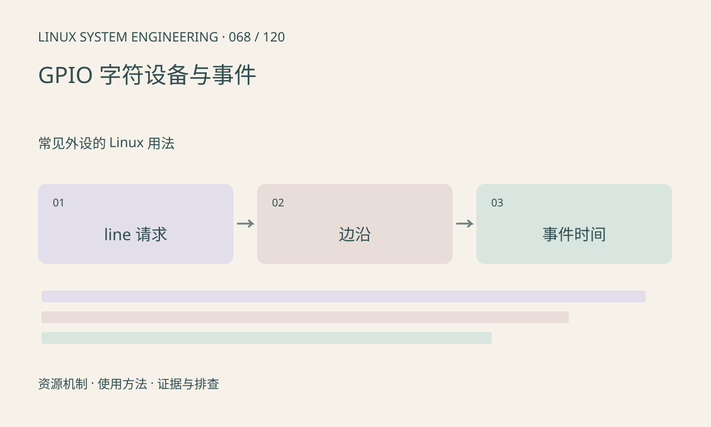

> 第 68 / 120 课 · 常见外设的 Linux 用法。返回[课程合集](/series/embedded-linux-system-engineering/)。

## 机制与资源关系

GPIO line 请求建立所有权和配置，释放请求后电平保持行为取决于硬件与驱动，不能默认永久保持。边沿事件有时间戳和缓冲限制，用户态调度延迟与真实边沿时间不同。



## 实际用法与观察入口

以下是操作说明；先确认执行环境、工具帮助和目标对象。设备名、PID、地址及项目名示例需要按实际替换，不能将整段命令当通用板端脚本执行。

```sh
gpioinfo --help
gpiomon --help
# 先确认当前 libgpiod 版本支持的选择方式
```

## 输出解读与排查顺序

libgpiod 不同主要版本的命令参数有差异，先查看本机帮助。观察外部输入前确认电平和偏置；机械按键会抖动，不能把每个边沿直接当一次按键。

### 情境推演

机械按键一次动作出现多次边沿，不宜立即认定 GPIO 驱动中断风暴。先观察时间间隔、偏置与波形，再设计消抖。软件抑制窗口需要符合响应时间要求。

## 练习与参考分析

设计按键事件日志：line、边沿、事件时间、处理时间及消抖结果。参考结论：事件时间与处理时间的差才反映软件接收延迟的一部分。

本课练习属于阅读、分析或板端观察。未在目标开发板执行，记录时应写明板型、内核配置、工具版本和原始输出。

## 官方资料与版本边界

- [本课参考资料](https://libgpiod.readthedocs.io/en/master/gpio_tools.html)

内核、工具和厂商 BSP 的支持范围需分别核对。参考资料可能对应较新版本；不要据此推定旧 BSP 支持所有接口。

[上一课：SPI、spidev 与传输](/posts/linux-sys-067.html) · [下一课：PWM、定时器与控制输出](/posts/linux-sys-069.html)
