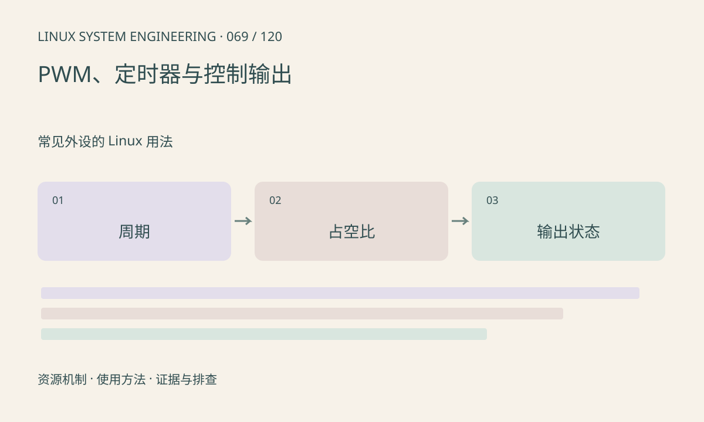

> 第 69 / 120 课 · 常见外设的 Linux 用法。返回[课程合集](/series/embedded-linux-system-engineering/)。

## 机制与资源关系

硬件 PWM 由控制器产生周期，用户态定时 sleep 翻转 GPIO 不能等价替代。周期、占空比和极性要满足驱动及硬件限制，更新时的行为也因控制器而异。



## 实际用法与观察入口

以下是操作说明；先确认执行环境、工具帮助和目标对象。设备名、PID、地址及项目名示例需要按实际替换，不能将整段命令当通用板端脚本执行。

```sh
ls /sys/class/pwm
# 在已有 pwmchip 目录中查看可用通道数量
cat /sys/class/pwm/pwmchip0/npwm
```

## 输出解读与排查顺序

只读查看不证明输出引脚复用正确。实际启用 PWM 会驱动外部负载，须先确认电路、范围和停止方案；本文不自动 export 或 enable。

### 情境推演

程序退出后 PWM 是否继续输出取决于接口与驱动，不应默认自动安全停止。测试前定义退出与异常时输出状态，并通过真实负载允许的方式验证。

## 练习与参考分析

计算 20ms 周期内 1.5ms 脉宽占空比为 7.5%。参考结论：某个舵机采用该范围不能推广到所有设备，应查执行器规格并限制边界。

本课练习属于阅读、分析或板端观察。未在目标开发板执行，记录时应写明板型、内核配置、工具版本和原始输出。

## 官方资料与版本边界

- [本课参考资料](https://docs.kernel.org/driver-api/pwm.html)

内核、工具和厂商 BSP 的支持范围需分别核对。参考资料可能对应较新版本；不要据此推定旧 BSP 支持所有接口。

[上一课：GPIO 字符设备与事件](/posts/linux-sys-068.html) · [下一课：ADC、传感器与 IIO](/posts/linux-sys-070.html)
