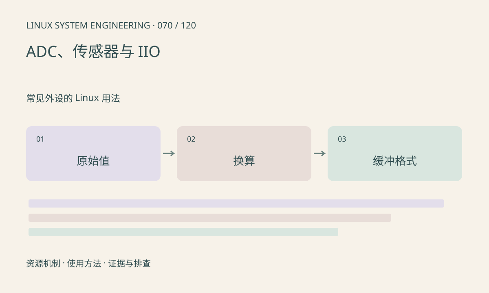

> 第 70 / 120 课 · 常见外设的 Linux 用法。返回[课程合集](/series/embedded-linux-system-engineering/)。

## 机制与资源关系

IIO 将采样通道、量程、偏移、触发和缓冲组织成接口。原始值可能需要按 (raw+offset)×scale 换算，但具体通道 ABI 和单位必须确认。缓冲数据还涉及 scan_elements、字节序和对齐。



## 实际用法与观察入口

以下是操作说明；先确认执行环境、工具帮助和目标对象。设备名、PID、地址及项目名示例需要按实际替换，不能将整段命令当通用板端脚本执行。

```sh
ls /sys/bus/iio/devices
# 按实际设备替换编号，先查看可用属性
ls /sys/bus/iio/devices/iio:device0
```

## 输出解读与排查顺序

直接读取属性与触发缓冲采集是不同路径。读数不变要检查通道、参考电压、采样触发和饱和；不要在不知道 scan 格式时按固定 C 结构解码整个流。

### 情境推演

缓冲每个样本按 16 位容器保存 12 位有效数据，还可能有移位和大小端属性。直接按主机 uint16_t 解码容易得到错误幅值，应读取 scan type 并按 ABI 解析。

## 练习与参考分析

给定 raw=1000、offset=-10、scale=0.001，计算结果 0.99，并写明假设单位。参考结论：数值换算正确不证明参考电压或模拟前端校准正确。

本课练习属于阅读、分析或板端观察。未在目标开发板执行，记录时应写明板型、内核配置、工具版本和原始输出。

## 官方资料与版本边界

- [本课参考资料](https://docs.kernel.org/driver-api/iio/index.html)

内核、工具和厂商 BSP 的支持范围需分别核对。参考资料可能对应较新版本；不要据此推定旧 BSP 支持所有接口。

[上一课：PWM、定时器与控制输出](/posts/linux-sys-069.html) · [下一课：input、按键与触摸事件](/posts/linux-sys-071.html)
