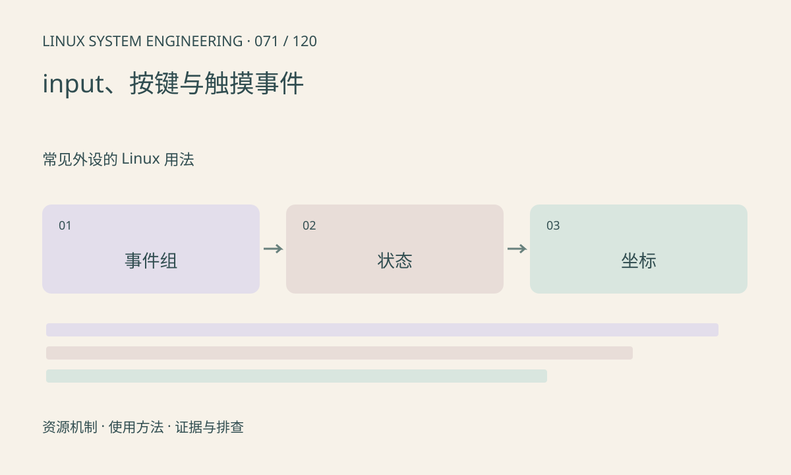

> 第 71 / 120 课 · 常见外设的 Linux 用法。返回[课程合集](/series/embedded-linux-system-engineering/)。

## 机制与资源关系

evdev 以类型、代码和值表达事件，SYN_REPORT 划分一组更新。多点触摸可能用 slot 协议，不能只处理单个绝对坐标。读取设备需要权限，事件丢失时还需重新同步状态。



## 实际用法与观察入口

以下是操作说明；先确认执行环境、工具帮助和目标对象。设备名、PID、地址及项目名示例需要按实际替换，不能将整段命令当通用板端脚本执行。

```sh
cat /proc/bus/input/devices
ls /dev/input
# 安装 evtest 且确认设备后交互观察
evtest
```

## 输出解读与排查顺序

先识别事件节点及能力，避免把键盘事件当触摸坐标。原始坐标到屏幕坐标还可能有旋转、范围缩放和校准。读取正常不代表应用选对了输入设备。

### 情境推演

触摸点在旋转屏幕上位置镜像，但原始事件连续正常。应核对坐标轴、范围和旋转转换，而不是调高采样率。多点触摸还要保留 slot 身份和抬起事件。

## 练习与参考分析

解释一次按下、自动重复、释放的事件值区别。参考结论：应用应按设备能力和事件组解释输入，而不是根据日志行数统计点击。

本课练习属于阅读、分析或板端观察。未在目标开发板执行，记录时应写明板型、内核配置、工具版本和原始输出。

## 官方资料与版本边界

- [本课参考资料](https://docs.kernel.org/input/event-codes.html)

内核、工具和厂商 BSP 的支持范围需分别核对。参考资料可能对应较新版本；不要据此推定旧 BSP 支持所有接口。

[上一课：ADC、传感器与 IIO](/posts/linux-sys-070.html) · [下一课：CAN、SocketCAN 与错误状态](/posts/linux-sys-072.html)
