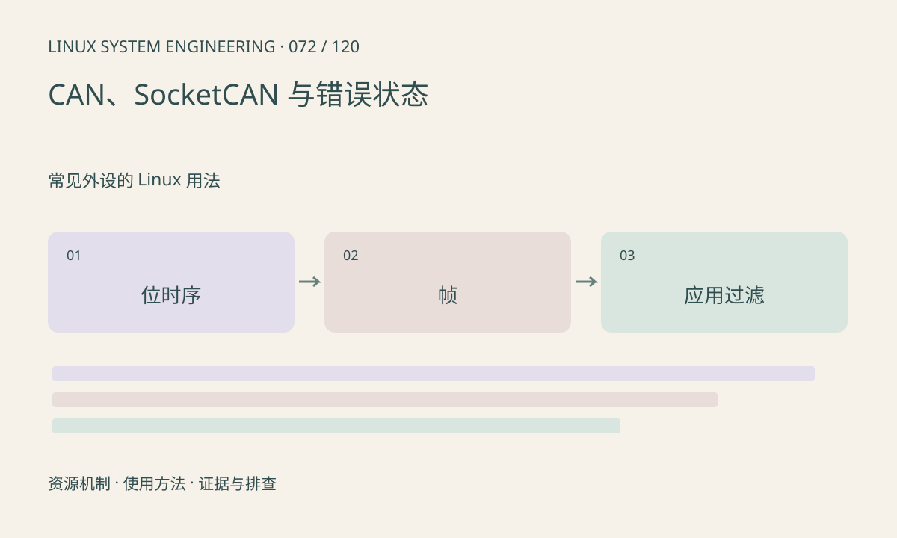

> 第 72 / 120 课 · 常见外设的 Linux 用法。返回[课程合集](/series/embedded-linux-system-engineering/)。

## 机制与资源关系

SocketCAN 将 CAN 控制器接入网络栈，应用使用 CAN socket。物理位时序、收发器、终端和错误状态仍需单独检查。CAN FD 还涉及数据阶段速率和双方能力。



## 实际用法与观察入口

以下是操作说明；先确认执行环境、工具帮助和目标对象。设备名、PID、地址及项目名示例需要按实际替换，不能将整段命令当通用板端脚本执行。

```sh
# 接口名按板子调整，仅查询
ip -details -statistics link show can0
cat /proc/net/can/stats
```

## 输出解读与排查顺序

bus-off 与应用没有收到指定 ID 是不同问题。检查错误计数、接口状态、过滤器和对端；ACK 不代表目标应用处理了消息。本文不设置 bitrate 或自动恢复策略。

### 情境推演

接口错误计数稳定且总线上有帧，但应用没收到目标 ID，检查过滤掩码和标准/扩展帧标志。若 bus-off，则先解决物理层和位时序，再恢复业务。

## 练习与参考分析

在专用测试环境可用 vcan 练习 socket 协议；创建接口需权限且不在本课自动执行。参考结论：vcan 验证软件消息处理，不验证仲裁、物理线和位时序。

本课练习属于阅读、分析或板端观察。未在目标开发板执行，记录时应写明板型、内核配置、工具版本和原始输出。

## 官方资料与版本边界

- [本课参考资料](https://docs.kernel.org/networking/can.html)

内核、工具和厂商 BSP 的支持范围需分别核对。参考资料可能对应较新版本；不要据此推定旧 BSP 支持所有接口。

[上一课：input、按键与触摸事件](/posts/linux-sys-071.html) · [下一课：USB 枚举、描述符与端点](/posts/linux-sys-073.html)
