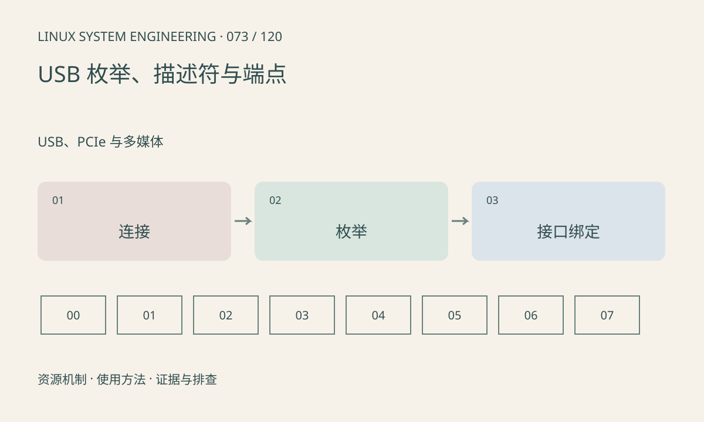

> 第 73 / 120 课 · USB、PCIe 与多媒体。返回[课程合集](/series/embedded-linux-system-engineering/)。

## 机制与资源关系

USB 主机枚举设备并读取描述符，再由驱动匹配接口。一个物理设备可以有多个接口，绑定不同驱动。端点方向以主机视角定义，bulk、interrupt、isochronous 的调度和可靠性特点不同。



## 实际用法与观察入口

以下是操作说明；先确认执行环境、工具帮助和目标对象。设备名、PID、地址及项目名示例需要按实际替换，不能将整段命令当通用板端脚本执行。

```sh
ls /sys/bus/usb/devices
# 安装 usbutils 时
lsusb
lsusb -t
```

## 输出解读与排查顺序

区分未发现设备、枚举失败、驱动未绑定和传输异常。反复 disconnect 要结合供电、线缆和日志，不能只重启应用。设备声明的速率与当前协商速率要分别看。

### 情境推演

lsusb 能看到 VID/PID，但目标 /dev 节点不存在。继续检查接口描述符及匹配驱动，不要把枚举成功等同于功能驱动已加载。复合设备的不同接口可能由不同模块处理。

## 练习与参考分析

从一个真实设备记录 VID/PID、接口类、驱动和树上的速率。参考结论：USB 3 接口外形不能保证设备当前运行在 SuperSpeed。

本课练习属于阅读、分析或板端观察。未在目标开发板执行，记录时应写明板型、内核配置、工具版本和原始输出。

## 官方资料与版本边界

- [本课参考资料](https://docs.kernel.org/driver-api/usb/usb.html)

内核、工具和厂商 BSP 的支持范围需分别核对。参考资料可能对应较新版本；不要据此推定旧 BSP 支持所有接口。

[上一课：CAN、SocketCAN 与错误状态](/posts/linux-sys-072.html) · [下一课：USB Host、Gadget 与 UVC](/posts/linux-sys-074.html)
