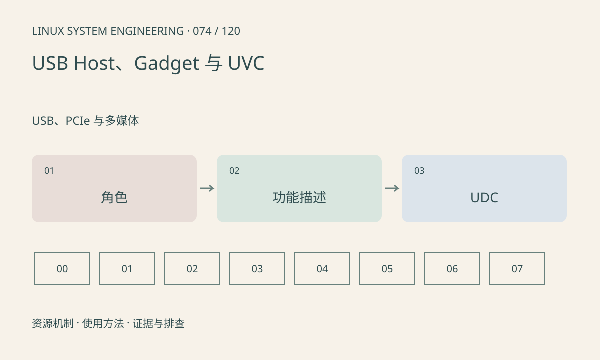

> 第 74 / 120 课 · USB、PCIe 与多媒体。返回[课程合集](/series/embedded-linux-system-engineering/)。

## 机制与资源关系

Host 管理总线，Gadget 把板子呈现为 USB 设备，双角色控制器还涉及角色切换。UVC 是视频设备类，不能因为内核有摄像头驱动就认为板子能作为 USB 摄像头输出。



## 实际用法与观察入口

以下是操作说明；先确认执行环境、工具帮助和目标对象。设备名、PID、地址及项目名示例需要按实际替换，不能将整段命令当通用板端脚本执行。

```sh
ls /sys/class/udc
ls /sys/class/usb_role
ls /sys/kernel/config/usb_gadget
```

## 输出解读与排查顺序

目录缺失可能是配置、挂载或硬件角色限制。Gadget 配置需要组合描述符、功能与 UDC；绑定会改变 USB 对外行为，本文只观察，不修改 configfs。

### 情境推演

板子插入 PC 无设备，板上 Host 模式却可读取 U 盘。说明 Host 路径工作，不能证明 Gadget 配置或设备角色支持。核对控制器角色、线缆和 UDC，再查功能组合。

## 练习与参考分析

画“PC 摄像头接板”和“板作为摄像头接 PC”两条路径。参考结论：它们分别需要 Host/UVC 接收和 Gadget/UVC 输出，驱动配置与缓冲方向不同。

本课练习属于阅读、分析或板端观察。未在目标开发板执行，记录时应写明板型、内核配置、工具版本和原始输出。

## 官方资料与版本边界

- [本课参考资料](https://docs.kernel.org/usb/gadget_configfs.html)

内核、工具和厂商 BSP 的支持范围需分别核对。参考资料可能对应较新版本；不要据此推定旧 BSP 支持所有接口。

[上一课：USB 枚举、描述符与端点](/posts/linux-sys-073.html) · [下一课：PCIe 枚举、BAR、MSI 与 DMA](/posts/linux-sys-075.html)
