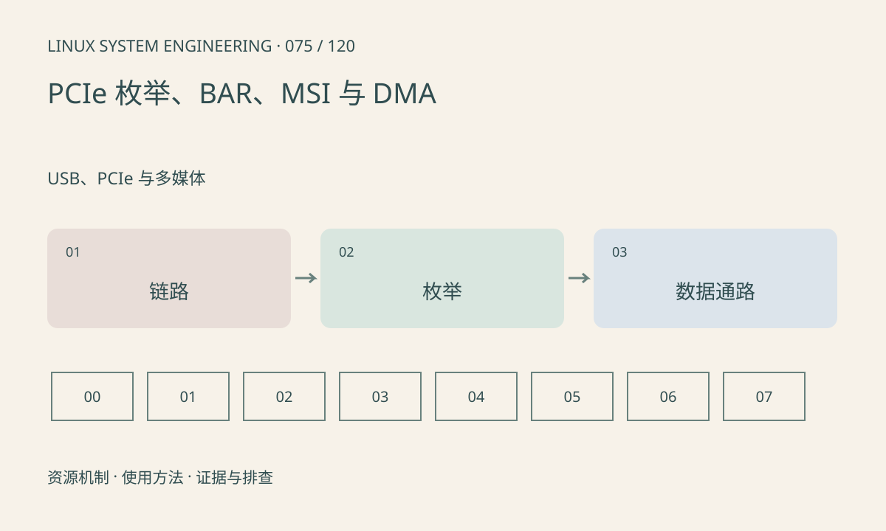

> 第 75 / 120 课 · USB、PCIe 与多媒体。返回[课程合集](/series/embedded-linux-system-engineering/)。

## 机制与资源关系

PCIe 链路建立、配置空间可读、资源分配、驱动绑定、DMA 成功是逐层推进的。BAR 描述设备资源窗口，不是任意用户态指针。MSI/MSI-X 中断和 DMA 地址还受平台路由与 IOMMU 影响。



## 实际用法与观察入口

以下是操作说明；先确认执行环境、工具帮助和目标对象。设备名、PID、地址及项目名示例需要按实际替换，不能将整段命令当通用板端脚本执行。

```sh
ls /sys/bus/pci/devices
# 安装 pciutils 时
lspci -nnk
lspci -t
```

## 输出解读与排查顺序

设备不在列表先查电源、复位、参考时钟和链路；设备已枚举再看资源、驱动与中断。本文不通过 setpci 改配置，也不对运行设备执行 reset。

### 情境推演

PCIe 设备可枚举，但提交 DMA 后无完成中断。继续检查描述符地址、DMA mask、映射返回、设备状态和 MSI 配置，不能只依据链路速率排除软件错误。

## 练习与参考分析

按“能枚举但超时”列出 IRQ、DMA mask、映射和完成队列证据。参考结论：读到 Vendor ID 只证明配置访问，不能保证高速数据通路正常。

本课练习属于阅读、分析或板端观察。未在目标开发板执行，记录时应写明板型、内核配置、工具版本和原始输出。

## 官方资料与版本边界

- [本课参考资料](https://docs.kernel.org/PCI/pci.html)

内核、工具和厂商 BSP 的支持范围需分别核对。参考资料可能对应较新版本；不要据此推定旧 BSP 支持所有接口。

[上一课：USB Host、Gadget 与 UVC](/posts/linux-sys-074.html) · [下一课：V4L2 采集与缓冲队列](/posts/linux-sys-076.html)
