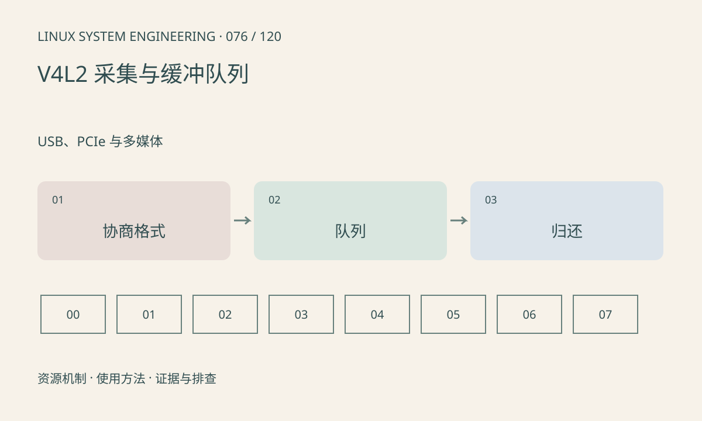

> 第 76 / 120 课 · USB、PCIe 与多媒体。返回[课程合集](/series/embedded-linux-system-engineering/)。

## 机制与资源关系

典型流式采集经历能力查询、格式协商、申请缓冲、入队、启动、出队和再入队。应用必须使用协商后的 stride、sizeimage 和像素格式，不能只按宽×高猜缓冲大小。多平面 API 也不同于单平面。



## 实际用法与观察入口

以下是操作说明；先确认执行环境、工具帮助和目标对象。设备名、PID、地址及项目名示例需要按实际替换，不能将整段命令当通用板端脚本执行。

```sh
# 安装 v4l-utils 且设备存在时，仅查询
v4l2-ctl -d /dev/video0 --all
v4l2-ctl -d /dev/video0 --list-formats-ext
```

## 输出解读与排查顺序

出队超时检查上游出流、队列深度、是否归还缓冲和帧序号。指针生命周期不能超出持有期；把已重新入队的缓冲交给异步 NPU 会造成并发覆盖。

### 情境推演

DQBUF 后立即 QBUF，同时把该地址交给异步推理，下一帧可能覆盖输入。解决方法是延长持有、复制到独立缓冲或设计共享完成协议，不能只扩大图像 stride。

## 练习与参考分析

画 4 个缓冲的 QBUF→驱动填充→DQBUF→消费→QBUF 循环。参考结论：消费者持有全部缓冲时采集停顿属于所有权问题，不应先加大超时。

本课练习属于阅读、分析或板端观察。未在目标开发板执行，记录时应写明板型、内核配置、工具版本和原始输出。

## 官方资料与版本边界

- [本课参考资料](https://docs.kernel.org/userspace-api/media/v4l/mmap.html)

内核、工具和厂商 BSP 的支持范围需分别核对。参考资料可能对应较新版本；不要据此推定旧 BSP 支持所有接口。

[上一课：PCIe 枚举、BAR、MSI 与 DMA](/posts/linux-sys-075.html) · [下一课：Media Controller 与摄像头拓扑](/posts/linux-sys-077.html)
