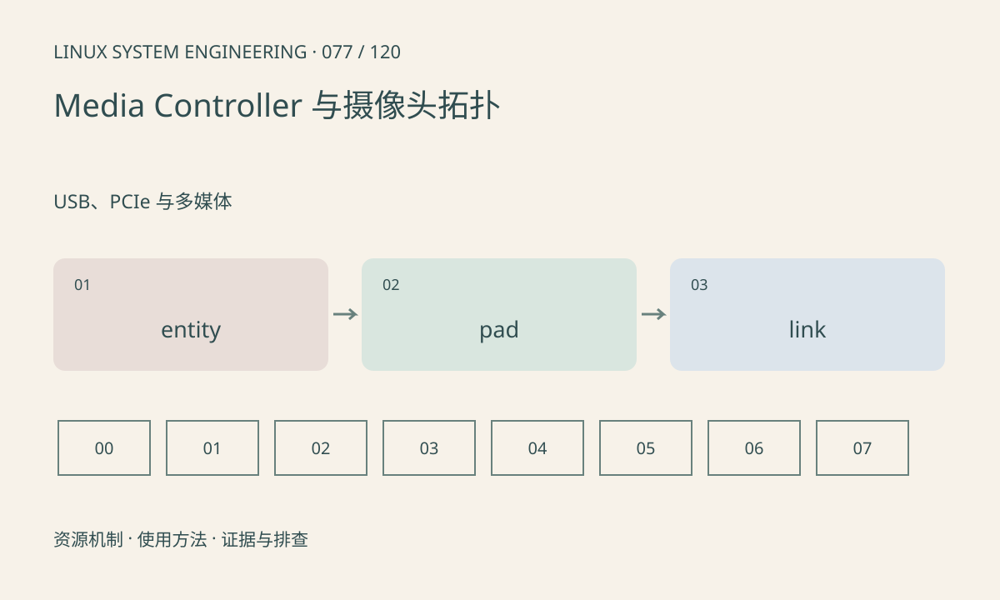

> 第 77 / 120 课 · USB、PCIe 与多媒体。返回[课程合集](/series/embedded-linux-system-engineering/)。

## 机制与资源关系

Media Controller 用 entity、pad 和 link 表达媒体管线；subdev 描述 sensor、接收器等子设备。视频节点格式正确不保证上游 pad 格式与裁剪设置一致，异步绑定也可能尚未完成。



## 实际用法与观察入口

以下是操作说明；先确认执行环境、工具帮助和目标对象。设备名、PID、地址及项目名示例需要按实际替换，不能将整段命令当通用板端脚本执行。

```sh
# v4l-utils 工具；只读拓扑
media-ctl -d /dev/media0 -p
ls /dev/v4l-subdev*
```

## 输出解读与排查顺序

从 sensor 沿启用 link 追踪到 video 节点，核对 media bus code、尺寸和路由。设置 link 或格式会改变管线，需在停止业务并明确配置时实施。

### 情境推演

video 节点设置为 1080p，但上游 subdev 仍输出另一尺寸。应沿 media graph 核对每个 pad 和路由；末端设置成功不证明中间所有组件已接受同一管线配置。

## 练习与参考分析

标出 RAW sensor 到 ISP 再到 NV12 输出的格式变化。参考结论：RAW 总线格式与内存 NV12 不是同一命名空间，不能把两端格式字符串直接比较。

本课练习属于阅读、分析或板端观察。未在目标开发板执行，记录时应写明板型、内核配置、工具版本和原始输出。

## 官方资料与版本边界

- [本课参考资料](https://docs.kernel.org/userspace-api/media/mediactl/media-controller.html)

内核、工具和厂商 BSP 的支持范围需分别核对。参考资料可能对应较新版本；不要据此推定旧 BSP 支持所有接口。

[上一课：V4L2 采集与缓冲队列](/posts/linux-sys-076.html) · [下一课：ALSA、PCM 与音频欠载](/posts/linux-sys-078.html)
