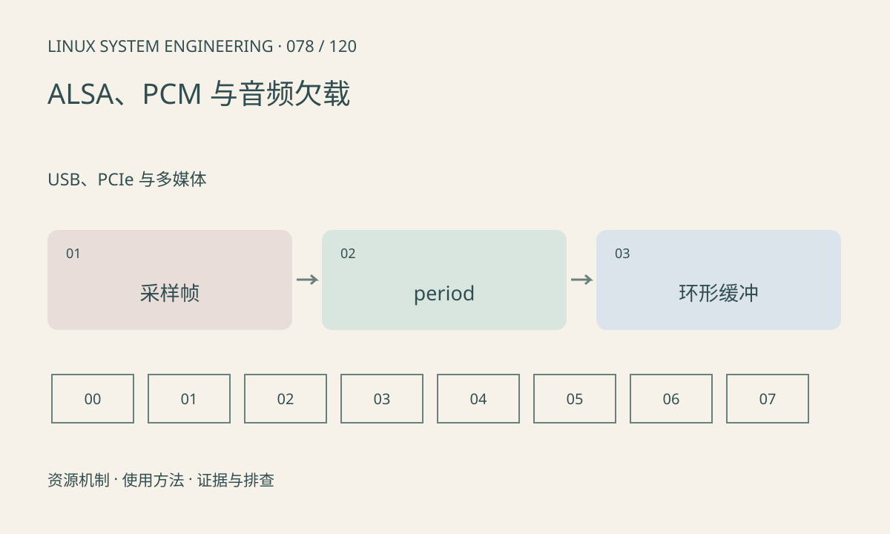

> 第 78 / 120 课 · USB、PCIe 与多媒体。返回[课程合集](/series/embedded-linux-system-engineering/)。

## 机制与资源关系

ALSA PCM 把采样流组织为环形缓冲和 period，frame 包含同一采样时刻的各通道数据。采样位宽、容器位宽、通道数和采样率共同决定字节速率。xrun 表示供给或消费未跟上时序。



## 实际用法与观察入口

以下是操作说明；先确认执行环境、工具帮助和目标对象。设备名、PID、地址及项目名示例需要按实际替换，不能将整段命令当通用板端脚本执行。

```sh
cat /proc/asound/cards
cat /proc/asound/pcm
# 工具存在时仅列设备
aplay -l
arecord -l
```

## 输出解读与排查顺序

先查硬件设备和协商参数，再查调度、DMA 和应用处理。调大 buffer 可缓解调度抖动，却增加延迟；短时恢复 xrun 不等于解决持续处理过慢。

### 情境推演

每 period 480 帧、48kHz 时名义上是 10ms 数据。应用若偶尔停顿 50ms，需结合总 buffer 容量判断是否欠载；period 大小不等于完整缓冲大小。

## 练习与参考分析

计算 48kHz、双声道、每样本 32 位容器的流量为 384000B/s。参考结论：24 位有效音频存入 32 位容器时，应按容器宽度预算内存。

本课练习属于阅读、分析或板端观察。未在目标开发板执行，记录时应写明板型、内核配置、工具版本和原始输出。

## 官方资料与版本边界

- [本课参考资料](https://www.alsa-project.org/alsa-doc/alsa-lib/pcm.html)

内核、工具和厂商 BSP 的支持范围需分别核对。参考资料可能对应较新版本；不要据此推定旧 BSP 支持所有接口。

[上一课：Media Controller 与摄像头拓扑](/posts/linux-sys-077.html) · [下一课：DRM、KMS 与显示缓冲](/posts/linux-sys-079.html)
