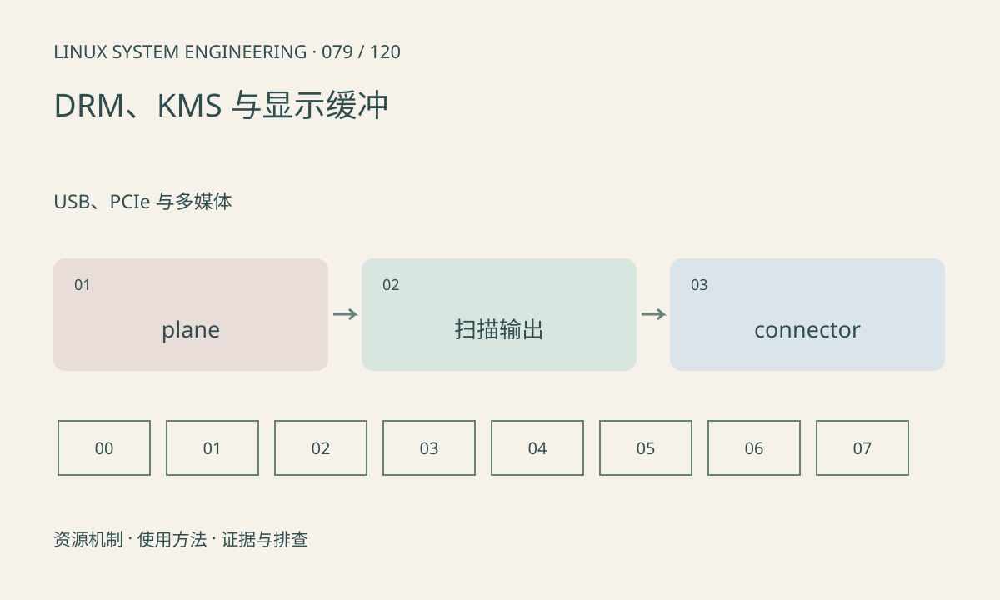

> 第 79 / 120 课 · USB、PCIe 与多媒体。返回[课程合集](/series/embedded-linux-system-engineering/)。

## 机制与资源关系

DRM/KMS 用 connector、encoder、CRTC 和 plane 表达显示资源。帧缓冲还带像素格式、pitch 和 modifier，不能把任意连续像素数组直接交给任意 plane。页面翻转完成也有异步生命周期。



## 实际用法与观察入口

以下是操作说明；先确认执行环境、工具帮助和目标对象。设备名、PID、地址及项目名示例需要按实际替换，不能将整段命令当通用板端脚本执行。

```sh
ls /sys/class/drm
ls /dev/dri
# 安装 libdrm 测试工具时，仅枚举
modetest -c -p
```

## 输出解读与排查顺序

黑屏先查 connector、模式、面板供电和背光，再查提交状态。modetest 的设置模式可能抢占显示，本课不执行。厂商 framebuffer 路径与 DRM 需分别识别。

### 情境推演

应用更新帧缓冲后立刻释放，显示硬件可能仍在扫描。应等待相应完成或释放协议。黑屏还需先排除 connector、模式、背光和面板初始化问题。

## 练习与参考分析

画应用缓冲→plane→CRTC→connector→面板的关系。参考结论：背光亮仅证明背光通路，不证明像素时序、面板初始化和显示内容正确。

本课练习属于阅读、分析或板端观察。未在目标开发板执行，记录时应写明板型、内核配置、工具版本和原始输出。

## 官方资料与版本边界

- [本课参考资料](https://docs.kernel.org/gpu/drm-kms.html)

内核、工具和厂商 BSP 的支持范围需分别核对。参考资料可能对应较新版本；不要据此推定旧 BSP 支持所有接口。

[上一课：ALSA、PCM 与音频欠载](/posts/linux-sys-078.html) · [下一课：厂商视频 SDK 与 NPU 资源](/posts/linux-sys-080.html)
