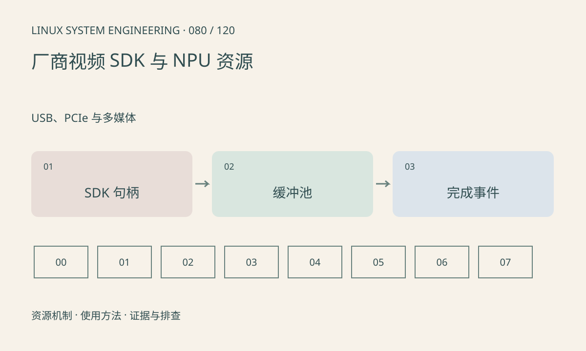

> 第 80 / 120 课 · USB、PCIe 与多媒体。返回[课程合集](/series/embedded-linux-system-engineering/)。

## 机制与资源关系

厂商 SDK 常把采集、处理、编码和推理封装为模块及通道。绑定可能走硬件直连或共享缓冲，也可能隐含转换。API 返回成功、任务提交成功与设备计算完成必须分开。



## 实际用法与观察入口

以下是操作说明；先确认执行环境、工具帮助和目标对象。设备名、PID、地址及项目名示例需要按实际替换，不能将整段命令当通用板端脚本执行。

```sh
cat /proc/meminfo
cat /proc/modules
ls /dev
# 厂商专属节点和调试命令按实际 SDK 手册另列
```

## 输出解读与排查顺序

为每个 get/release、map/unmap、submit/wait 建账，记录帧号、格式、stride 和时间。不要虚构通用的 MMZ、VB 或 NPU 命令；同厂不同 BSP 也可能不兼容。

### 情境推演

SDK 的 get_frame 成功后，异常分支没有 release_frame，运行一段时间池耗尽。为成功获取次数和最终释放次数记账，按在途任务解释差值，避免只在正常路径归还。

## 练习与参考分析

制作 SDK API 与 Linux 资源对应表，标出哪个接口只是申请、哪个表示完成。参考结论：模型执行很快但端到端慢，仍可能是排队、转换和拷贝。

本课练习属于阅读、分析或板端观察。未在目标开发板执行，记录时应写明板型、内核配置、工具版本和原始输出。

## 官方资料与版本边界

- [本课参考资料](https://docs.kernel.org/driver-api/dma-buf.html)

内核、工具和厂商 BSP 的支持范围需分别核对。参考资料可能对应较新版本；不要据此推定旧 BSP 支持所有接口。

[上一课：DRM、KMS 与显示缓冲](/posts/linux-sys-079.html) · [下一课：网卡、MAC、PHY 与链路状态](/posts/linux-sys-081.html)
