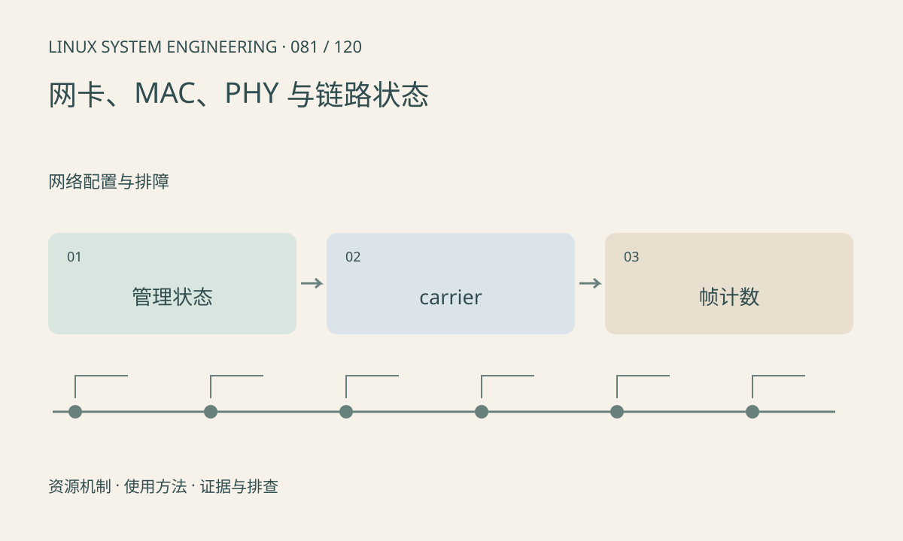

> 第 81 / 120 课 · 网络配置与排障。返回[课程合集](/series/embedded-linux-system-engineering/)。

## 机制与资源关系

网卡逻辑状态 UP 与物理 carrier 是不同条件。MAC 处理帧，PHY 负责物理链路，MDIO 常用于管理 PHY。链路建立不保证 IP 配置、路由或应用服务正确。



## 实际用法与观察入口

以下是操作说明；先确认执行环境、工具帮助和目标对象。设备名、PID、地址及项目名示例需要按实际替换，不能将整段命令当通用板端脚本执行。

```sh
ip -s link show
ls /sys/class/net
# 按实际网卡替换 eth0
ethtool eth0
```

## 输出解读与排查顺序

观察协商速率、双工和错误增量，再结合交换机端口。工具或驱动不支持某统计时记为未知；不要把总 dropped 一律归因于网线。

### 情境推演

eth0 UP、carrier=0，先查 PHY、线缆、交换机口和供电。若 carrier=1 且收发计数增加，再进入网络层；两种状态不应使用同一“重配 IP”策略。

## 练习与参考分析

解释“接口 UP 但 NO-CARRIER”和“有 carrier 但无法 ping”的差别。参考结论：前者优先物理链路，后者继续 IP、邻居、路由及过滤规则。

本课练习属于阅读、分析或板端观察。未在目标开发板执行，记录时应写明板型、内核配置、工具版本和原始输出。

## 官方资料与版本边界

- [本课参考资料](https://docs.kernel.org/networking/phy.html)

内核、工具和厂商 BSP 的支持范围需分别核对。参考资料可能对应较新版本；不要据此推定旧 BSP 支持所有接口。

[上一课：厂商视频 SDK 与 NPU 资源](/posts/linux-sys-080.html) · [下一课：IP、子网、路由与邻居表](/posts/linux-sys-082.html)
