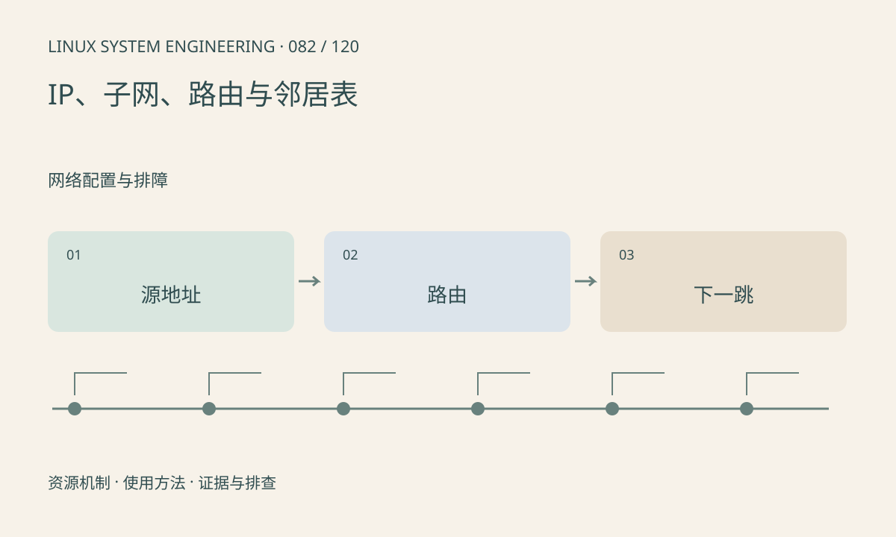

> 第 82 / 120 课 · 网络配置与排障。返回[课程合集](/series/embedded-linux-system-engineering/)。

## 机制与资源关系

发送 IP 数据先按路由决定出口及下一跳，再解析相邻链路层地址。ARP 用于 IPv4 邻居解析，IPv6 使用邻居发现。不同前缀、策略路由和多网卡可能使回程走不同路径。



## 实际用法与观察入口

以下是操作说明；先确认执行环境、工具帮助和目标对象。设备名、PID、地址及项目名示例需要按实际替换，不能将整段命令当通用板端脚本执行。

```sh
ip address show
ip route show
ip rule show
ip neigh show
ip route get 192.0.2.10
```

## 输出解读与排查顺序

从实际源地址和目标地址推导路由，不要只看默认路由。邻居 INCOMPLETE 提示解析未完成，但原因可在对端、VLAN、链路或过滤。查询命令不会修复配置。

### 情境推演

多网卡设备请求从 eth0 发出，回复却受策略走另一出口。记录源地址、ip rule 和具体 route get 结果，不能只展示一条默认路由就断言网络配置正确。

## 练习与参考分析

给两台板配置纸面的地址/前缀/网关并判断是否直接邻接。参考结论：同为 192.168 开头不保证同子网，必须结合前缀长度。

本课练习属于阅读、分析或板端观察。未在目标开发板执行，记录时应写明板型、内核配置、工具版本和原始输出。

## 官方资料与版本边界

- [本课参考资料](https://man7.org/linux/man-pages/man8/ip-route.8.html)

内核、工具和厂商 BSP 的支持范围需分别核对。参考资料可能对应较新版本；不要据此推定旧 BSP 支持所有接口。

[上一课：网卡、MAC、PHY 与链路状态](/posts/linux-sys-081.html) · [下一课：DHCP、DNS 与时间同步](/posts/linux-sys-083.html)
