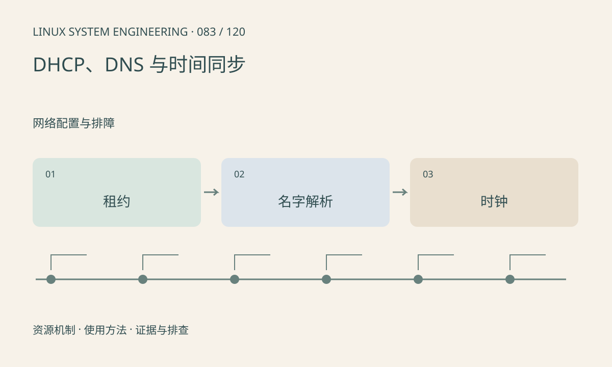

> 第 83 / 120 课 · 网络配置与排障。返回[课程合集](/series/embedded-linux-system-engineering/)。

## 机制与资源关系

DHCP 提供地址及租约配置，DNS 负责名字解析，NTP 等协议校准时钟，三者独立。能访问 IP 却不能访问域名时，应隔离 DNS；TLS 失败还可能涉及系统时间和证书验证。



## 实际用法与观察入口

以下是操作说明；先确认执行环境、工具帮助和目标对象。设备名、PID、地址及项目名示例需要按实际替换，不能将整段命令当通用板端脚本执行。

```sh
cat /etc/resolv.conf
cat /proc/net/route
date -u
# 工具可用时，替换实际域名
getent hosts example.com
```

## 输出解读与排查顺序

嵌入式环境的 resolv.conf 可能由 DHCP 脚本覆盖，直接修改未必持久。记录客户端、配置源和更新时间。测试时不要通过关闭证书检查掩盖错误时钟。

### 情境推演

直接访问 IP 正常，域名解析失败，应查 resolver 配置来源与 DNS 服务器响应。若解析成功但 TLS 验证失败，再核对时间、证书和主机名，保留验证机制。

## 练习与参考分析

分析 DHCP 成功而域名失败的路径。参考结论：地址租约成功不证明 DNS 服务器可达或解析正确；先区分名字解析与后续连接。

本课练习属于阅读、分析或板端观察。未在目标开发板执行，记录时应写明板型、内核配置、工具版本和原始输出。

## 官方资料与版本边界

- [本课参考资料](https://man7.org/linux/man-pages/man5/resolv.conf.5.html)

内核、工具和厂商 BSP 的支持范围需分别核对。参考资料可能对应较新版本；不要据此推定旧 BSP 支持所有接口。

[上一课：IP、子网、路由与邻居表](/posts/linux-sys-082.html) · [下一课：TCP、UDP 与 socket 缓冲](/posts/linux-sys-084.html)
