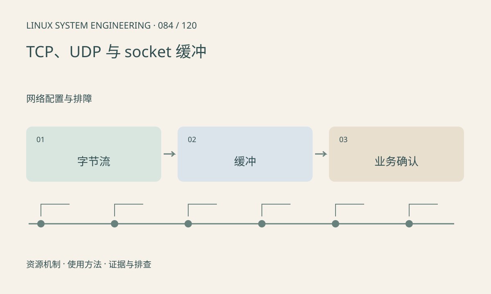

> 第 84 / 120 课 · 网络配置与排障。返回[课程合集](/series/embedded-linux-system-engineering/)。

## 机制与资源关系

TCP 提供有序字节流，应用仍需消息边界和超时协议；UDP 保留数据报边界但不保证送达。send 成功通常表示本地接受数据，不证明远端应用处理完成。缓冲大小不能补足长期吞吐缺口。



## 实际用法与观察入口

以下是操作说明；先确认执行环境、工具帮助和目标对象。设备名、PID、地址及项目名示例需要按实际替换，不能将整段命令当通用板端脚本执行。

```sh
cat /proc/net/sockstat
cat /proc/net/snmp
ss -s
```

## 输出解读与排查顺序

区分连接建立、发送排队、网络传输和业务确认。接收端处理慢可能压缩 TCP 窗口；UDP 则可能出现本地队列丢弃。统计需按窗口和连接关联。

### 情境推演

发送 100 字节后对端分 40、60 两次收到属于正常 TCP 行为。接收器应按协议重组；对端完成业务后返回应用 ACK 才能证明已处理，而非只依赖 send 返回。

## 练习与参考分析

设计长度前缀协议并考虑分两次收到头部。参考结论：一次 recv 不保证得到完整业务帧，必须保存解析状态并限制声明长度。

### 独立实验包

主机内存中的拆包练习；不建立 TCP 连接，不模拟重传或拥塞。 默认入口、源文件和实际运行记录都在下载包中。

```experiment
practice
```

## 官方资料与版本边界

- [本课参考资料](https://man7.org/linux/man-pages/man7/tcp.7.html)

内核、工具和厂商 BSP 的支持范围需分别核对。参考资料可能对应较新版本；不要据此推定旧 BSP 支持所有接口。

[上一课：DHCP、DNS 与时间同步](/posts/linux-sys-083.html) · [下一课：ss、抓包与协议分析](/posts/linux-sys-085.html)
