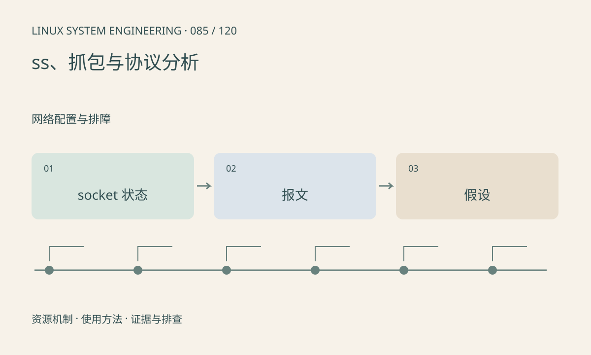

> 第 85 / 120 课 · 网络配置与排障。返回[课程合集](/series/embedded-linux-system-engineering/)。

## 机制与资源关系

ss 展示 socket 状态，抓包观察特定位置的网络数据，两者回答不同问题。网卡卸载可能让本机抓包呈现大包或校验和异常，应结合驱动特性判断。抓不到包也可能是接口和过滤器选错。



## 实际用法与观察入口

以下是操作说明；先确认执行环境、工具帮助和目标对象。设备名、PID、地址及项目名示例需要按实际替换，不能将整段命令当通用板端脚本执行。

```sh
ss -lntup
ss -tin
# 仅在测试网络且有权限时，限量抓取目标流量
tcpdump -i eth0 -nn -c 20 host 192.0.2.10
```

## 输出解读与排查顺序

先定义要验证的假设，例如 SYN 是否发出、对端是否回复。抓包包含通信内容，应限定范围和保存权限；被动抓取也会增加少量负载。

### 情境推演

抓到 SYN 和 SYN-ACK，却未见后续业务数据，要确认三次握手、应用是否发送及抓包点。校验和卸载可能让本机捕获显示异常，需结合对端抓包或卸载配置判断。

## 练习与参考分析

给 SYN 重试、RST、正常连接后无业务响应分别列下一步。参考结论：握手成功只证明 TCP 建立，不证明应用协议、鉴权或数据处理成功。

本课练习属于阅读、分析或板端观察。未在目标开发板执行，记录时应写明板型、内核配置、工具版本和原始输出。

## 官方资料与版本边界

- [本课参考资料](https://man7.org/linux/man-pages/man8/ss.8.html)

内核、工具和厂商 BSP 的支持范围需分别核对。参考资料可能对应较新版本；不要据此推定旧 BSP 支持所有接口。

[上一课：TCP、UDP 与 socket 缓冲](/posts/linux-sys-084.html) · [下一课：吞吐、重传、MTU 与延迟](/posts/linux-sys-086.html)
