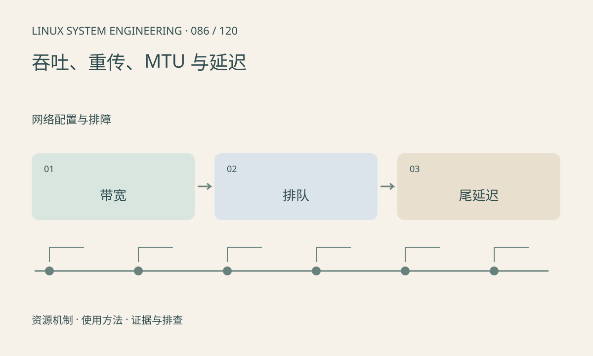

> 第 86 / 120 课 · 网络配置与排障。返回[课程合集](/series/embedded-linux-system-engineering/)。

## 机制与资源关系

吞吐与单包延迟不是同一目标，批处理可能提高前者却增加后者。MTU、拥塞、接收窗口、CPU 和驱动队列都会影响传输。单次 iperf 不能代表真实视频业务的帧龄。



## 实际用法与观察入口

以下是操作说明；先确认执行环境、工具帮助和目标对象。设备名、PID、地址及项目名示例需要按实际替换，不能将整段命令当通用板端脚本执行。

```sh
ip -s link show
ss -ti
cat /proc/net/snmp
cat /proc/net/softnet_stat
```

## 输出解读与排查顺序

测试固定方向、时长、并发和包大小，并同时观察 CPU 与错误增量。测速会占用链路，只在专用窗口执行。softnet_stat 字段随内核需查证，不能随意按一列定性。

### 情境推演

平均网络延迟 5ms，但每分钟一次 300ms 停顿会破坏跟随控制。报告至少包含分位数、最大值和异常窗口，并说明样本数量，不能只报平均值。

## 练习与参考分析

把采集到显示拆成队列、编码、网络、解码和显示时段。参考结论：吞吐足够仍可能因缓冲积压产生秒级延迟，应记录尾延迟和结果年龄。

本课练习属于阅读、分析或板端观察。未在目标开发板执行，记录时应写明板型、内核配置、工具版本和原始输出。

## 官方资料与版本边界

- [本课参考资料](https://docs.kernel.org/networking/scaling.html)

内核、工具和厂商 BSP 的支持范围需分别核对。参考资料可能对应较新版本；不要据此推定旧 BSP 支持所有接口。

[上一课：ss、抓包与协议分析](/posts/linux-sys-085.html) · [下一课：Wi-Fi、蜂窝模块与重连](/posts/linux-sys-087.html)
