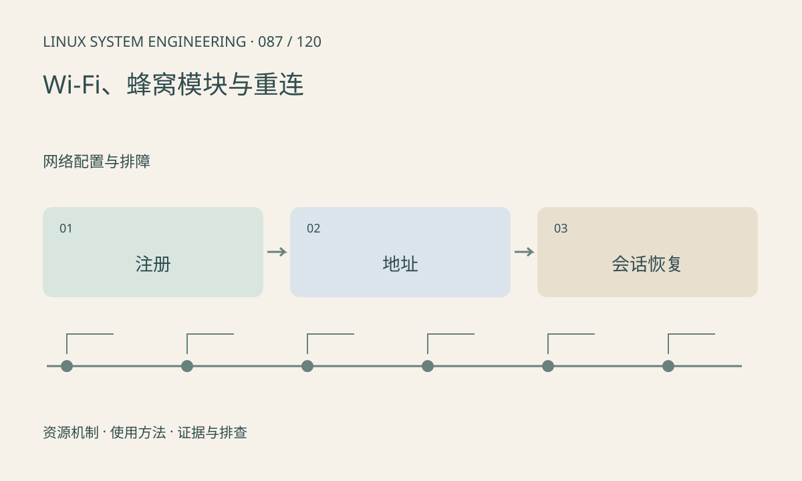

> 第 87 / 120 课 · 网络配置与排障。返回[课程合集](/series/embedded-linux-system-engineering/)。

## 机制与资源关系

无线连接包括设备总线、固件、射频关联、认证和 IP 配置多个层次。蜂窝模块还可能通过控制端口管理注册、拨号及数据接口。USB 枚举成功不等于已经入网。



## 实际用法与观察入口

以下是操作说明；先确认执行环境、工具帮助和目标对象。设备名、PID、地址及项目名示例需要按实际替换，不能将整段命令当通用板端脚本执行。

```sh
ip link show
# 工具存在时，仅观察
iw dev
rfkill list
ls /sys/class/net
```

## 输出解读与排查顺序

掉线要保存原因码、信号、注册和地址状态。重连应有退避、上限和业务恢复协议，避免多个守护进程争抢同一设备。不要在日志里输出 SIM 凭据和完整认证信息。

### 情境推演

Wi-Fi 已重新关联，但 DHCP 尚未拿到地址，应用立即重连会持续失败。状态机应按层推进并限制重试；恢复 IP 后还需重建业务会话或处理未确认数据。

## 练习与参考分析

画断网后“链路恢复→地址恢复→业务会话恢复”状态机。参考结论：网络接口重新 UP 后，旧 socket 和未确认业务仍需应用处理。

本课练习属于阅读、分析或板端观察。未在目标开发板执行，记录时应写明板型、内核配置、工具版本和原始输出。

## 官方资料与版本边界

- [本课参考资料](https://wireless.docs.kernel.org/en/latest/en/users/documentation/iw.html)

内核、工具和厂商 BSP 的支持范围需分别核对。参考资料可能对应较新版本；不要据此推定旧 BSP 支持所有接口。

[上一课：吞吐、重传、MTU 与延迟](/posts/linux-sys-086.html) · [下一课：防火墙、转发、NAT 与隔离](/posts/linux-sys-088.html)
