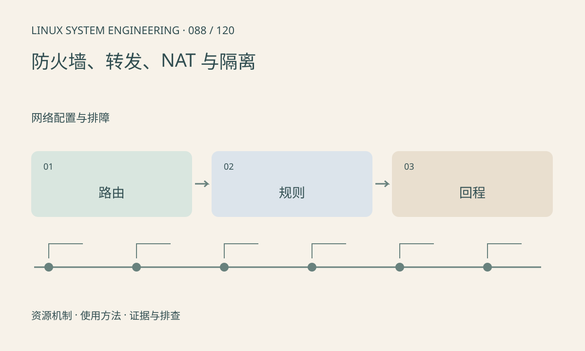

> 第 88 / 120 课 · 网络配置与排障。返回[课程合集](/series/embedded-linux-system-engineering/)。

## 机制与资源关系

本机接收、转发和本机发送经过不同网络处理路径。NAT 改变地址或端口，不等同于放行规则；内核转发开关、路由、过滤和回程需要共同满足。容器还可能增加独立网络命名空间。



## 实际用法与观察入口

以下是操作说明；先确认执行环境、工具帮助和目标对象。设备名、PID、地址及项目名示例需要按实际替换，不能将整段命令当通用板端脚本执行。

```sh
cat /proc/sys/net/ipv4/ip_forward
ip route show
# nftables 系统且具备查询权限时
nft list ruleset
```

## 输出解读与排查顺序

先确认使用 nftables 还是其他管理方式，避免同时由多个工具覆盖规则。不要用清空全部规则验证连通性；应通过受控日志或计数定位命中的规则。

### 情境推演

下游设备的数据到达板子但未从上游发出，先查转发开关和 FORWARD 路径计数。NAT 规则存在不能替代转发许可；回程没有路由也会表现为单向通信。

## 练习与参考分析

分析板子能上网但无法为另一设备转发的原因。参考结论：板自身连通不证明 forwarding、FORWARD 规则和下游回程路由正确。

本课练习属于阅读、分析或板端观察。未在目标开发板执行，记录时应写明板型、内核配置、工具版本和原始输出。

## 官方资料与版本边界

- [本课参考资料](https://wiki.nftables.org/wiki-nftables/index.php/Main_Page)

内核、工具和厂商 BSP 的支持范围需分别核对。参考资料可能对应较新版本；不要据此推定旧 BSP 支持所有接口。

[上一课：Wi-Fi、蜂窝模块与重连](/posts/linux-sys-087.html) · [下一课：交叉编译、sysroot 与 pkg-config](/posts/linux-sys-089.html)
