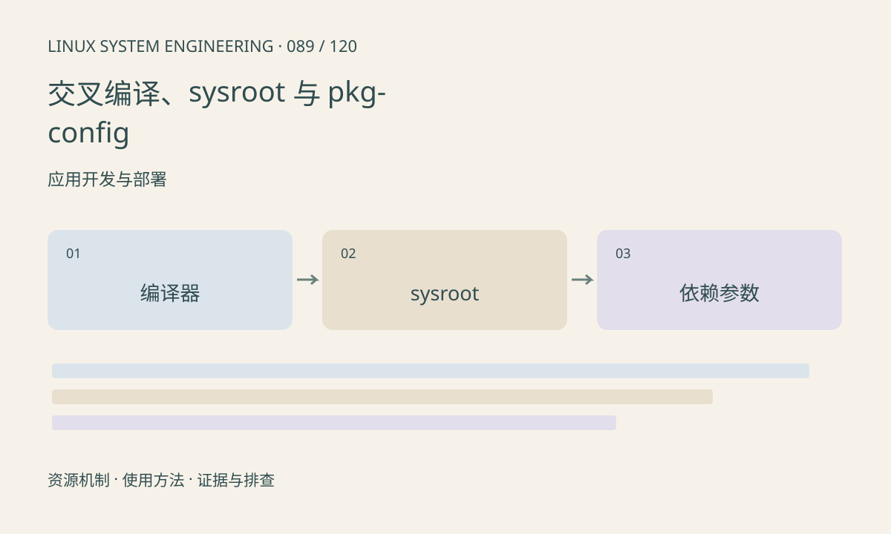

> 第 89 / 120 课 · 应用开发与部署。返回[课程合集](/series/embedded-linux-system-engineering/)。

## 机制与资源关系

编译器目标、头文件、链接库和运行时必须一致。sysroot 把查找路径限定到目标环境，pkg-config 提供包的编译链接参数，但错误搜索路径会偷偷引入主机库。



## 实际用法与观察入口

以下是操作说明；先确认执行环境、工具帮助和目标对象。设备名、PID、地址及项目名示例需要按实际替换，不能将整段命令当通用板端脚本执行。

```sh
# 主机工具链查询；交叉编译时替换 cc
cc -dumpmachine
cc --print-sysroot
pkg-config --variable pc_path pkg-config
```

## 输出解读与排查顺序

检查实际编译和链接命令，不只看环境变量。交叉编译应设置对应 pkg-config 搜索目录及 sysroot，避免将主机 /usr/lib 混入。SDK 环境脚本应来自相同目标版本。

### 情境推演

pkg-config 输出主机绝对路径时，检查 PKG_CONFIG_LIBDIR 和 PKG_CONFIG_SYSROOT_DIR 等配置，并查看工具链包装器。只改 CC 变量不保证其他构建探测和依赖路径已经切到目标。

## 练习与参考分析

运行独立 hello 构建，再用 readelf 检查架构和解释器。参考结论：能在主机运行只验证本机构建，不代表已完成交叉部署。

### 独立实验包

主机 Linux 的有界 C 实验；不访问真实外设，不代表板端时序或性能。 默认入口、源文件和实际运行记录都在下载包中。

```experiment
practice
```

## 官方资料与版本边界

- [本课参考资料](https://gcc.gnu.org/onlinedocs/gcc/Directory-Options.html)

内核、工具和厂商 BSP 的支持范围需分别核对。参考资料可能对应较新版本；不要据此推定旧 BSP 支持所有接口。

[上一课：防火墙、转发、NAT 与隔离](/posts/linux-sys-088.html) · [下一课：Make、CMake 与可重复构建](/posts/linux-sys-090.html)
