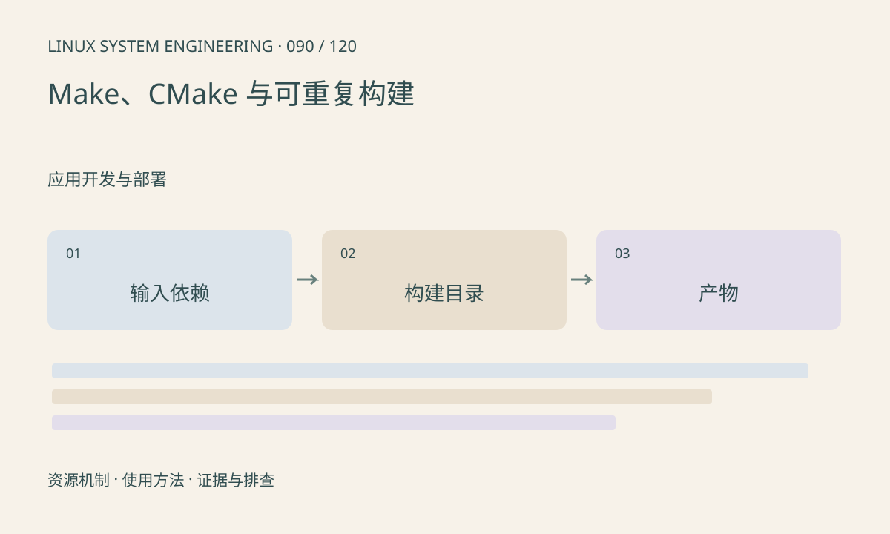

> 第 90 / 120 课 · 应用开发与部署。返回[课程合集](/series/embedded-linux-system-engineering/)。

## 机制与资源关系

构建系统根据依赖决定重建，依赖遗漏会留下旧产物。交叉 CMake 常用 toolchain file 描述编译器和查找策略；换工具链时复用旧 cache 容易混入旧探测结果。



## 实际用法与观察入口

以下是操作说明；先确认执行环境、工具帮助和目标对象。设备名、PID、地址及项目名示例需要按实际替换，不能将整段命令当通用板端脚本执行。

```sh
# 本课代码包提供最小 CMake 工程，主机独立构建
cmake -S . -B build
cmake --build build
./build/hello
```

## 输出解读与排查顺序

记录工具链、配置、源码和依赖版本，并从干净输出目录验证。不要把 make clean 当解释一切的修复；应找出依赖和缓存失配的原因。

### 情境推演

换交叉编译器后沿用旧 CMakeCache，可能保留旧编译测试和查找结果。为不同工具链使用独立构建目录，再验证头文件修改确实触发依赖重建。

## 练习与参考分析

修改头文件中的消息并确认重新构建会更新程序。参考结论：仅修改源码能触发重建还不够，生成头文件和外部依赖也应进入依赖图。

### 独立实验包

主机 CMake 构建，需 CMake 3.16+ 和 C 编译器；不代表交叉工具链已验证。 默认入口、源文件和实际运行记录都在下载包中。

```experiment
practice
```

## 官方资料与版本边界

- [本课参考资料](https://cmake.org/cmake/help/latest/manual/cmake-toolchains.7.html)

内核、工具和厂商 BSP 的支持范围需分别核对。参考资料可能对应较新版本；不要据此推定旧 BSP 支持所有接口。

[上一课：交叉编译、sysroot 与 pkg-config](/posts/linux-sys-089.html) · [下一课：ELF、库与动态加载器](/posts/linux-sys-091.html)
