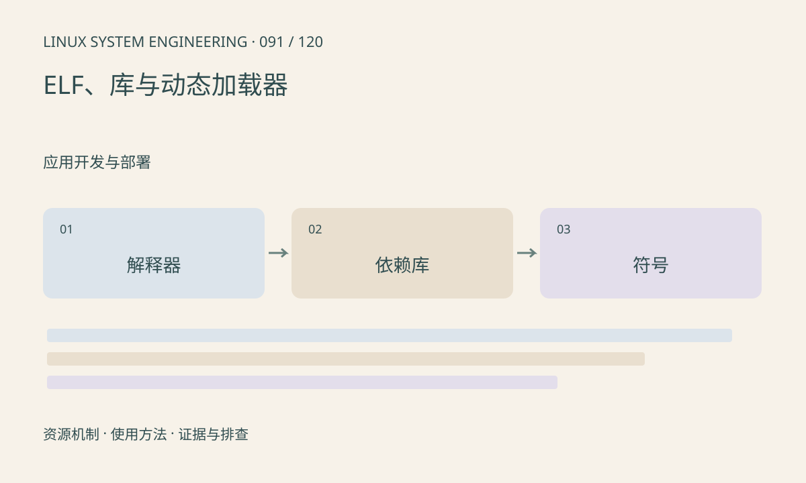

> 第 91 / 120 课 · 应用开发与部署。返回[课程合集](/series/embedded-linux-system-engineering/)。

## 机制与资源关系

静态链接把所需代码并入产物，动态链接由运行时加载器解析依赖。解释器路径写在 ELF 中，DT_NEEDED 描述依赖名，RUNPATH 等影响搜索。相同库文件名不保证符号版本和 ABI 兼容。



## 实际用法与观察入口

以下是操作说明；先确认执行环境、工具帮助和目标对象。设备名、PID、地址及项目名示例需要按实际替换，不能将整段命令当通用板端脚本执行。

```sh
# 主机只读检查可信的自有程序
readelf -l ./app
readelf -d ./app
readelf -Ws ./app
```

## 输出解读与排查顺序

优先静态检查目标 ELF，不把目标程序交给不匹配的主机加载器。LD_LIBRARY_PATH 适合受控诊断，但长期依赖全局设置可能掩盖错误安装布局。

### 情境推演

程序所需 libfoo.so 找到，但仍报 undefined symbol，说明库文件存在不是充分条件。核对具体符号、版本和 ABI，避免随意创建软链接伪装兼容版本。

## 练习与参考分析

为程序列出解释器和全部直接依赖，再检查间接依赖。参考结论：复制主程序不足以完成部署，必须满足加载器和兼容运行库。

本课练习属于阅读、分析或板端观察。未在目标开发板执行，记录时应写明板型、内核配置、工具版本和原始输出。

## 官方资料与版本边界

- [本课参考资料](https://man7.org/linux/man-pages/man8/ld.so.8.html)

内核、工具和厂商 BSP 的支持范围需分别核对。参考资料可能对应较新版本；不要据此推定旧 BSP 支持所有接口。

[上一课：Make、CMake 与可重复构建](/posts/linux-sys-090.html) · [下一课：程序无法启动的分层排查](/posts/linux-sys-092.html)
