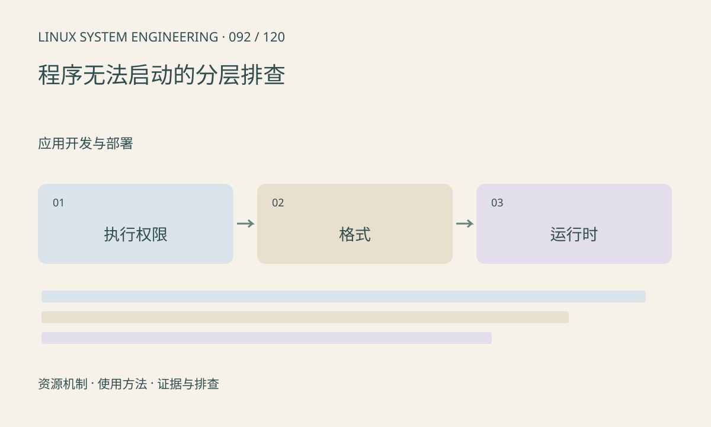

> 第 92 / 120 课 · 应用开发与部署。返回[课程合集](/series/embedded-linux-system-engineering/)。

## 机制与资源关系

Shell 执行失败可能来自权限、挂载 noexec、架构、解释器、动态库或脚本 shebang。脚本使用 CRLF 时解释器路径可能含额外字符，表现与脚本文件缺失很像。



## 实际用法与观察入口

以下是操作说明；先确认执行环境、工具帮助和目标对象。设备名、PID、地址及项目名示例需要按实际替换，不能将整段命令当通用板端脚本执行。

```sh
ls -l ./app
file ./app
readelf -h ./app
readelf -l ./app
cat /proc/mounts
```

## 输出解读与排查顺序

保留原始报错与退出码，先查是否进入了程序，再查程序内部初始化。不要见 Permission denied 就加 root，也不要用宿主机库替换目标库试错。

### 情境推演

app 在目录中且有执行位，运行仍提示 not found。readelf -l 显示的加载器路径如果不存在，就应补齐匹配运行时；继续 chmod 不会产生加载器。

## 练习与参考分析

把 ENOENT、ENOEXEC、EACCES 和缺少共享库错误分别对应检查项。参考结论：文件存在只能排除其中一个路径问题，不能证明执行链完整。

本课练习属于阅读、分析或板端观察。未在目标开发板执行，记录时应写明板型、内核配置、工具版本和原始输出。

## 官方资料与版本边界

- [本课参考资料](https://man7.org/linux/man-pages/man2/execve.2.html)

内核、工具和厂商 BSP 的支持范围需分别核对。参考资料可能对应较新版本；不要据此推定旧 BSP 支持所有接口。

[上一课：ELF、库与动态加载器](/posts/linux-sys-091.html) · [下一课：配置、日志与错误处理](/posts/linux-sys-093.html)
