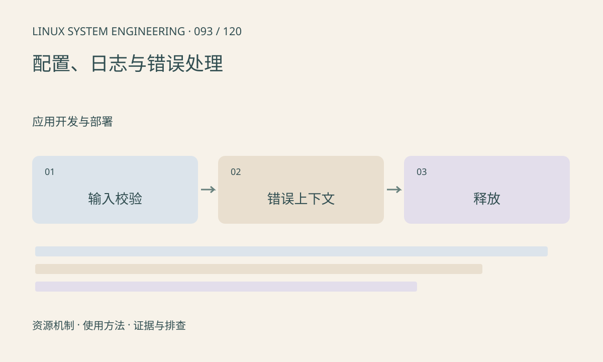

> 第 93 / 120 课 · 应用开发与部署。返回[课程合集](/series/embedded-linux-system-engineering/)。

## 机制与资源关系

配置必须定义类型、范围和默认值，错误输入应在资源申请前拒绝。日志要包含阶段、对象、错误码和时间，不能只有“failed”。异常分支与正常退出一样需要释放已获取资源。



## 实际用法与观察入口

以下是操作说明；先确认执行环境、工具帮助和目标对象。设备名、PID、地址及项目名示例需要按实际替换，不能将整段命令当通用板端脚本执行。

```sh
# 本课示例分别测试有效值与无效值
sh run.sh
```

## 输出解读与排查顺序

保存 errno 后再做可能改变它的调用；pthread 等接口则按各自返回约定处理。避免打印密码和大块原始视频；热路径日志应有等级、采样或限速。

### 情境推演

用户传入 16junk，atoi 可能只解析前缀，应用误认为有效配置。严格解析应检查结束位置、范围和溢出；错误消息包含字段名与允许范围，避免随后申请错误尺寸缓冲。

## 练习与参考分析

验证整数参数拒绝负数、尾随字符和溢出。参考结论：atoi 无法完整区分非法输入与合法零值，应使用可检查范围与结束位置的解析方式。

### 独立实验包

主机 Linux 的有界 C 实验；不访问真实外设，不代表板端时序或性能。 默认入口、源文件和实际运行记录都在下载包中。

```experiment
practice
```

## 官方资料与版本边界

- [本课参考资料](https://man7.org/linux/man-pages/man3/strtol.3.html)

内核、工具和厂商 BSP 的支持范围需分别核对。参考资料可能对应较新版本；不要据此推定旧 BSP 支持所有接口。

[上一课：程序无法启动的分层排查](/posts/linux-sys-092.html) · [下一课：服务管理、依赖与恢复](/posts/linux-sys-094.html)
