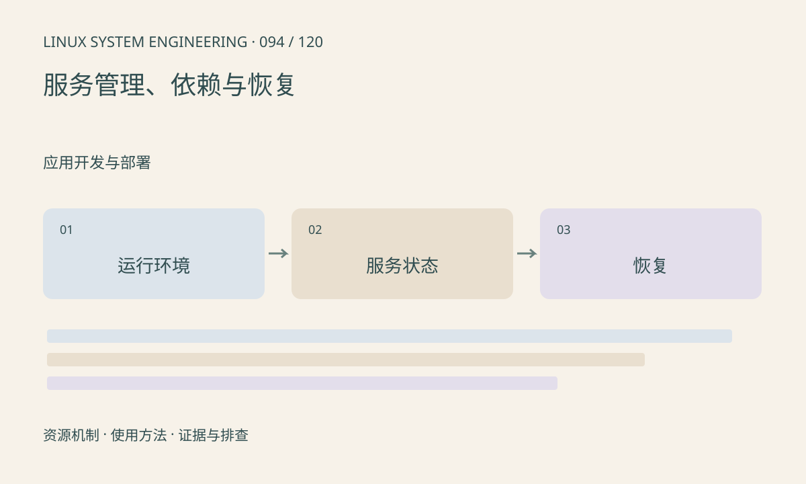

> 第 94 / 120 课 · 应用开发与部署。返回[课程合集](/series/embedded-linux-system-engineering/)。

## 机制与资源关系

守护程序应有清晰的前台运行模式、退出状态和停止协议，交由 init 管理。自动重启可以恢复服务，也可能造成失败风暴；启动限制、退避和失败证据需要一起设计。



## 实际用法与观察入口

以下是操作说明；先确认执行环境、工具帮助和目标对象。设备名、PID、地址及项目名示例需要按实际替换，不能将整段命令当通用板端脚本执行。

```sh
# systemd 系统，仅查询自有服务
systemctl status camera.service
systemctl cat camera.service
journalctl -u camera.service -b --no-pager
```

## 输出解读与排查顺序

检查运行用户、环境、目录、资源限制及设备依赖，与交互运行做对照。BusyBox init 场景应检查 inittab 和启动脚本，不照抄 systemctl。

### 情境推演

程序交互运行正常，服务启动失败，常见差异包括工作目录、用户组、环境和限制。先按 service 定义复现，避免在程序里硬编码开发者家目录。

## 练习与参考分析

设计采集服务停止顺序：停止生产→取消等待→归还缓冲→释放设备。参考结论：SIGKILL 不能替代有序关闭，重启后还需确认硬件已回到可用状态。

本课练习属于阅读、分析或板端观察。未在目标开发板执行，记录时应写明板型、内核配置、工具版本和原始输出。

## 官方资料与版本边界

- [本课参考资料](https://www.freedesktop.org/software/systemd/man/latest/systemd.service.html)

内核、工具和厂商 BSP 的支持范围需分别核对。参考资料可能对应较新版本；不要据此推定旧 BSP 支持所有接口。

[上一课：配置、日志与错误处理](/posts/linux-sys-093.html) · [下一课：capabilities 与设备访问](/posts/linux-sys-095.html)
