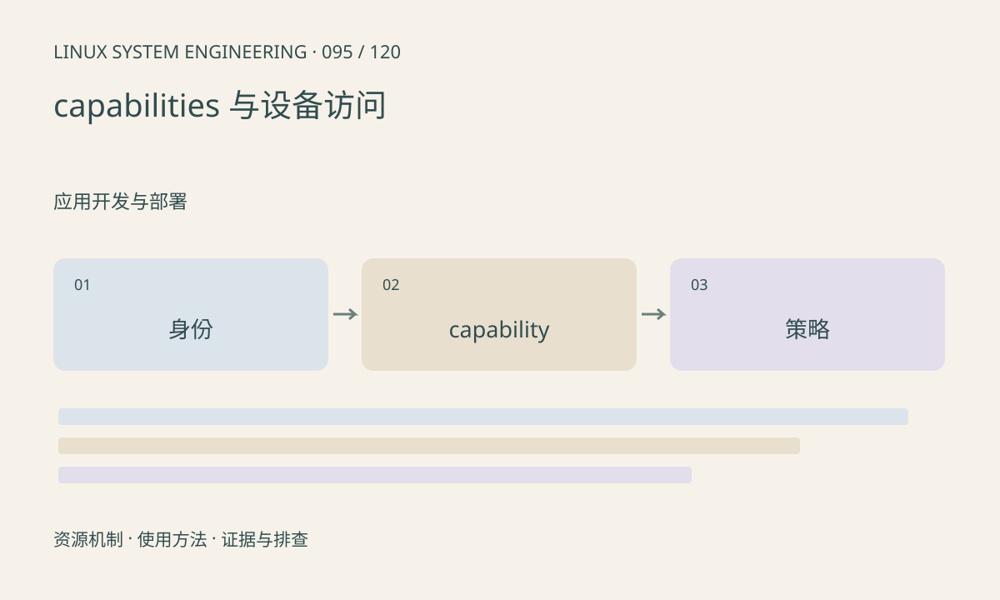

> 第 95 / 120 课 · 应用开发与部署。返回[课程合集](/series/embedded-linux-system-engineering/)。

## 机制与资源关系

Linux 将部分特权拆为 capabilities，但文件权限、namespace 和 LSM 仍共同影响访问。给程序全部 root 权限会扩大影响，也可能掩盖部署问题。容器内 root 与宿主机 root 的能力集合未必相同。



## 实际用法与观察入口

以下是操作说明；先确认执行环境、工具帮助和目标对象。设备名、PID、地址及项目名示例需要按实际替换，不能将整段命令当通用板端脚本执行。

```sh
id
cat /proc/self/status
cat /proc/self/attr/current
ls -l /dev/video0
```

## 输出解读与排查顺序

先确定哪个系统调用被拒绝，再查用户组、设备策略、capability 和安全模块日志。不要仅因 EPERM 就关闭 SELinux/AppArmor 或赋予所有能力。

### 情境推演

容器里 uid=0 仍无法访问性能计数器，说明身份与能力并非同一概念。记录实际失败调用和策略，按最小所需能力评估，不把 privileged 当最终配置。

## 练习与参考分析

为只读摄像头查询程序列最小访问条件。参考结论：文件可打开不保证所有 ioctl 都允许，具体权限可能在驱动和安全策略中继续检查。

本课练习属于阅读、分析或板端观察。未在目标开发板执行，记录时应写明板型、内核配置、工具版本和原始输出。

## 官方资料与版本边界

- [本课参考资料](https://man7.org/linux/man-pages/man7/capabilities.7.html)

内核、工具和厂商 BSP 的支持范围需分别核对。参考资料可能对应较新版本；不要据此推定旧 BSP 支持所有接口。

[上一课：服务管理、依赖与恢复](/posts/linux-sys-094.html) · [下一课：软件包、升级与回退](/posts/linux-sys-096.html)
