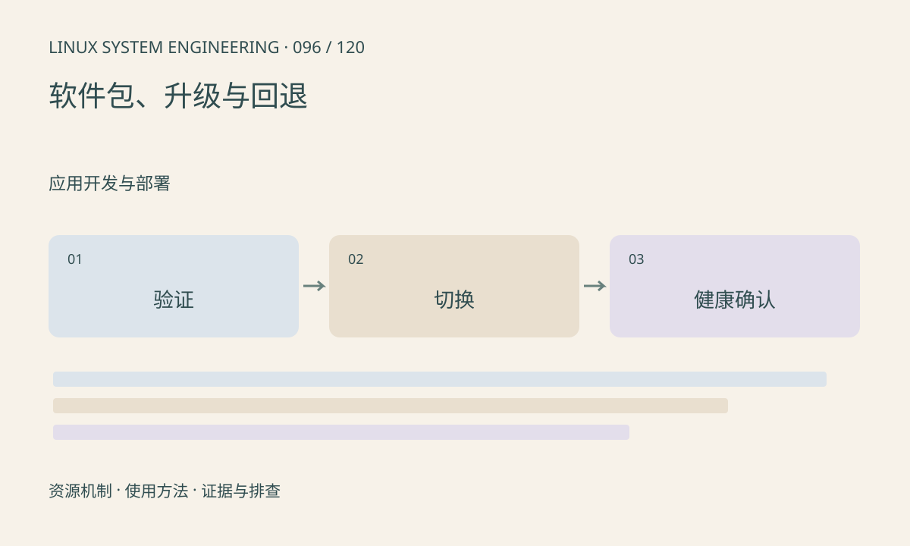

> 第 96 / 120 课 · 应用开发与部署。返回[课程合集](/series/embedded-linux-system-engineering/)。

## 机制与资源关系

升级要同时处理真实性、版本兼容、掉电恢复和配置迁移。A/B 保留可回退系统，但应用确认过早会把坏版本标成成功；健康检查应覆盖实际业务而不是进程存活。



## 实际用法与观察入口

以下是操作说明；先确认执行环境、工具帮助和目标对象。设备名、PID、地址及项目名示例需要按实际替换，不能将整段命令当通用板端脚本执行。

```sh
# 只读检查当前系统及挂载
cat /proc/cmdline
cat /proc/mounts
# 项目应额外提供固件清单和校验信息
```

## 输出解读与排查顺序

升级前明确分区、数据保留、签名验证与回退计数，禁止用本文泛化命令直接覆盖真实设备。配置迁移应考虑回退旧程序还能否读取新格式。

### 情境推演

新系统刚启动就标记成功，随后摄像头失败，旧槽再也不会自动回退。健康确认应等待关键业务闭环，并定义超时和尝试次数；确认动作需要持久化协议。

## 练习与参考分析

纸面演练写入中断、首次启动失败、健康检查失败三种情况。参考结论：每个阶段都应有可确定的下一启动选择，而不是依赖人工猜测槽位。

本课练习属于阅读、分析或板端观察。未在目标开发板执行，记录时应写明板型、内核配置、工具版本和原始输出。

## 官方资料与版本边界

- [本课参考资料](https://docs.u-boot.org/en/latest/usage/fit/verified-boot.html)

内核、工具和厂商 BSP 的支持范围需分别核对。参考资料可能对应较新版本；不要据此推定旧 BSP 支持所有接口。

[上一课：capabilities 与设备访问](/posts/linux-sys-095.html) · [下一课：strace 定位系统调用问题](/posts/linux-sys-097.html)
