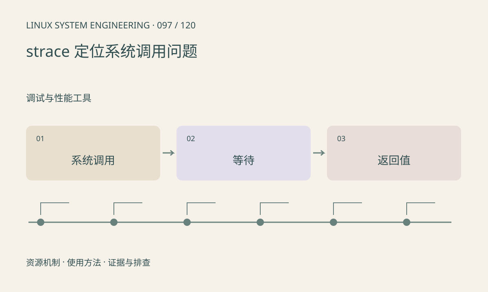

> 第 97 / 120 课 · 调试与性能工具。返回[课程合集](/series/embedded-linux-system-engineering/)。

## 机制与资源关系

strace 观察系统调用及信号，可回答程序卡在哪个内核接口、收到什么错误。它看不到所有用户态计算和锁逻辑，也可能显著改变时序。应从小范围复现开始。



## 实际用法与观察入口

以下是操作说明；先确认执行环境、工具帮助和目标对象。设备名、PID、地址及项目名示例需要按实际替换，不能将整段命令当通用板端脚本执行。

```sh
cc -g -O0 -Wall -Wextra -pthread main.c -o demo
strace -f -tt -T -o trace.txt ./demo
```

## 输出解读与排查顺序

-f 跟踪子进程和线程，-T 显示调用耗时。长 futex 只提示等待同步，不直接说明死锁；write 返回长度应与请求比较。附加其他进程可能受 ptrace 权限限制。

### 情境推演

strace 显示 read 持续阻塞，需要确认预期输入和所有写端；若频繁返回 EAGAIN 且 CPU 高，则可能忙轮询。相同“读不到数据”现象有不同修复方向。

## 练习与参考分析

对 pipe 示例跟踪 read、write 和 close，解释 EOF 出现条件。参考结论：关闭写端后 read=0 是正常结束，与 EAGAIN、EINTR 不同。 配套 run.sh 仅编译并运行被跟踪程序，strace 能力另行检查。

### 独立实验包

主机 Linux 的有界 C 实验；不访问真实外设，不代表板端时序或性能。 默认入口、源文件和实际运行记录都在下载包中。

```experiment
practice
```

## 官方资料与版本边界

- [本课参考资料](https://strace.io/)

内核、工具和厂商 BSP 的支持范围需分别核对。参考资料可能对应较新版本；不要据此推定旧 BSP 支持所有接口。

[上一课：软件包、升级与回退](/posts/linux-sys-096.html) · [下一课：GDB 与 gdbserver](/posts/linux-sys-098.html)
