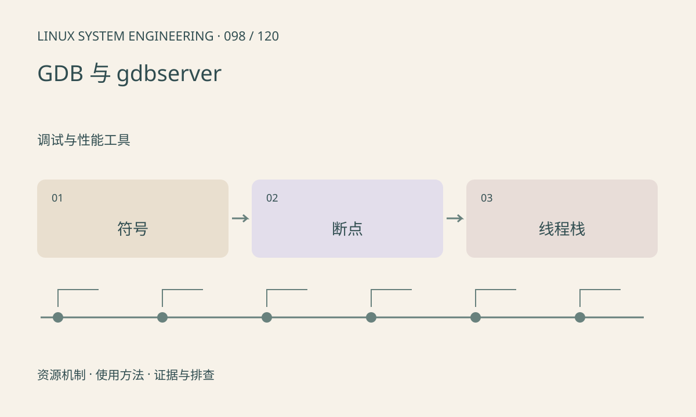

> 第 98 / 120 课 · 调试与性能工具。返回[课程合集](/series/embedded-linux-system-engineering/)。

## 机制与资源关系

调试符号把地址映射到函数和源行，优化可能内联函数或移除变量。交叉调试需要匹配目标架构和精确版本的二进制及库。附加调试会暂停线程，可能触发设备或服务超时。



## 实际用法与观察入口

以下是操作说明；先确认执行环境、工具帮助和目标对象。设备名、PID、地址及项目名示例需要按实际替换，不能将整段命令当通用板端脚本执行。

```sh
cc -g -O0 -Wall -Wextra -pthread main.c -o demo
gdb ./demo
# GDB 内：break add / run / bt / print left / continue
```

## 输出解读与排查顺序

先保存 Build ID 和未剥离符号。gdbserver 应运行在受控网络，按需绑定访问范围，不暴露到公网。没有符号时栈地址仍可保存，之后用匹配产物解析。

### 情境推演

优化构建中变量显示 optimized out，不表示内存被清空。可在专用调试构建中降低优化或检查汇编，但性能复现也可能受编译选项变化影响，需要说明条件。

## 练习与参考分析

在本课程序函数入口设断点，观察参数和调用栈。参考结论：源码相同但编译选项不同的符号文件也可能导致误定位。 配套 run.sh 仅编译并运行调试目标，交互式 GDB 与远程连接不在自动验证范围。

### 独立实验包

主机 Linux 的有界 C 实验；不访问真实外设，不代表板端时序或性能。 默认入口、源文件和实际运行记录都在下载包中。

```experiment
practice
```

## 官方资料与版本边界

- [本课参考资料](https://sourceware.org/gdb/current/onlinedocs/gdb.html/)

内核、工具和厂商 BSP 的支持范围需分别核对。参考资料可能对应较新版本；不要据此推定旧 BSP 支持所有接口。

[上一课：strace 定位系统调用问题](/posts/linux-sys-097.html) · [下一课：core dump、符号与回溯](/posts/linux-sys-099.html)
