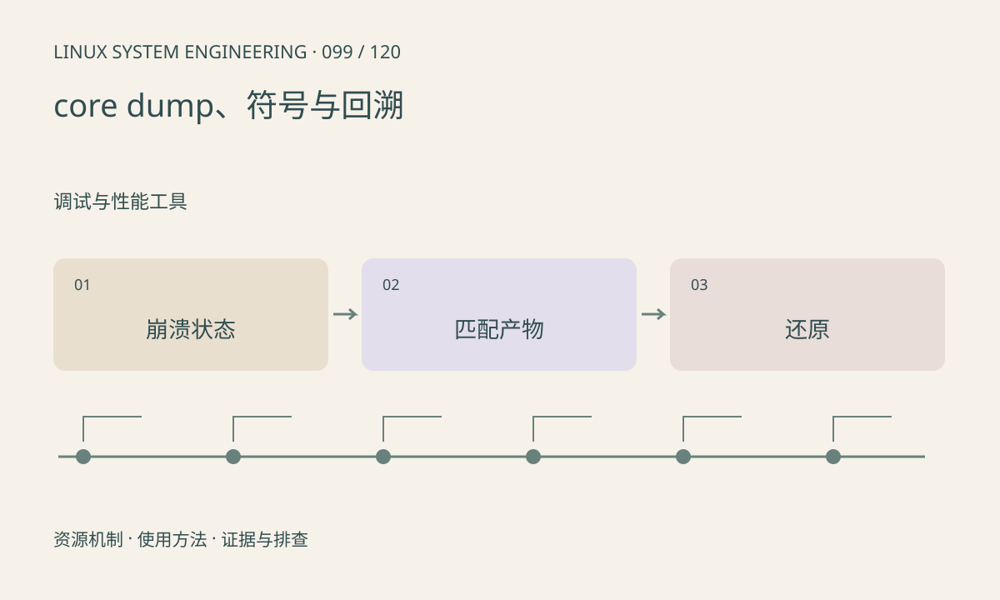

> 第 99 / 120 课 · 调试与性能工具。返回[课程合集](/series/embedded-linux-system-engineering/)。

## 机制与资源关系

core 保存进程异常时的部分状态，是否生成受资源限制、core_pattern、权限和服务策略影响。有些系统通过管道交给收集服务，不会在当前目录生成 core 文件。



## 实际用法与观察入口

以下是操作说明；先确认执行环境、工具帮助和目标对象。设备名、PID、地址及项目名示例需要按实际替换，不能将整段命令当通用板端脚本执行。

```sh
ulimit -c
cat /proc/sys/kernel/core_pattern
cat /proc/self/limits
```

## 输出解读与排查顺序

core 可能含敏感业务数据，应限制保留和访问。离线分析需要匹配主程序、库和符号；回溯位置可能是内存破坏的受害点，首次非法写入仍需其他工具追踪。

### 情境推演

core 来自固件 A，符号来自固件 B，回溯行号可能误导。用构建标识匹配主程序和库；首次内存破坏可能在崩溃之前，core 是线索而非完整历史。

## 练习与参考分析

制定 core、Build ID、配置和输入的配套保存清单。参考结论：只有 core 没有对应二进制，可能无法可靠还原现场；本课不主动制造崩溃。

本课练习属于阅读、分析或板端观察。未在目标开发板执行，记录时应写明板型、内核配置、工具版本和原始输出。

## 官方资料与版本边界

- [本课参考资料](https://man7.org/linux/man-pages/man5/core.5.html)

内核、工具和厂商 BSP 的支持范围需分别核对。参考资料可能对应较新版本；不要据此推定旧 BSP 支持所有接口。

[上一课：GDB 与 gdbserver](/posts/linux-sys-098.html) · [下一课：ASan、UBSan 与内存错误](/posts/linux-sys-100.html)
