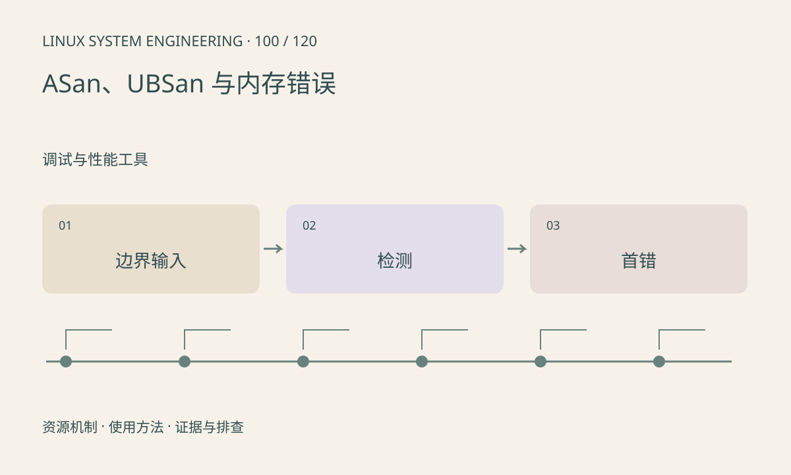

> 第 100 / 120 课 · 调试与性能工具。返回[课程合集](/series/embedded-linux-system-engineering/)。

## 机制与资源关系

ASan 检测多类越界和释放后使用，UBSan 检测部分未定义行为。它们需要工具链与运行库支持，覆盖不到所有逻辑错误。内存错误报告中的首次异常通常比后续连锁崩溃更有价值。



## 实际用法与观察入口

以下是操作说明；先确认执行环境、工具帮助和目标对象。设备名、PID、地址及项目名示例需要按实际替换，不能将整段命令当通用板端脚本执行。

```sh
# 在主机测试自有代码，先运行正常输入
cc -g -O1 -fsanitize=address,undefined -fno-omit-frame-pointer main.c -o demo
./demo
```

## 输出解读与排查顺序

对输入长度、索引和整数运算分别建立边界测试。sanitizer 运行会增加资源使用，嵌入式板内存不足时可先验证可移植模块，再在目标工具链补充。

### 情境推演

正常输入通过 ASan，超长输入才触发越界，说明验证覆盖依赖输入集。修复应检查长度契约并增加边界用例，不只是把数组改大到当前样例能放下。

## 练习与参考分析

把解析器的长度检查写在复制前，测试空输入、边界长度和超长输入。参考结论：正常样例没有报告不能证明任意输入安全，需覆盖失败路径。

### 独立实验包

主机 ASan+UBSan 构建和边界输入验证；没有故意触发越界，不代表覆盖任意输入或真实板端。

```experiment
practice
```

## 官方资料与版本边界

- [本课参考资料](https://gcc.gnu.org/onlinedocs/gcc/Instrumentation-Options.html)

内核、工具和厂商 BSP 的支持范围需分别核对。参考资料可能对应较新版本；不要据此推定旧 BSP 支持所有接口。

[上一课：core dump、符号与回溯](/posts/linux-sys-099.html) · [下一课：perf 与采样分析](/posts/linux-sys-101.html)
