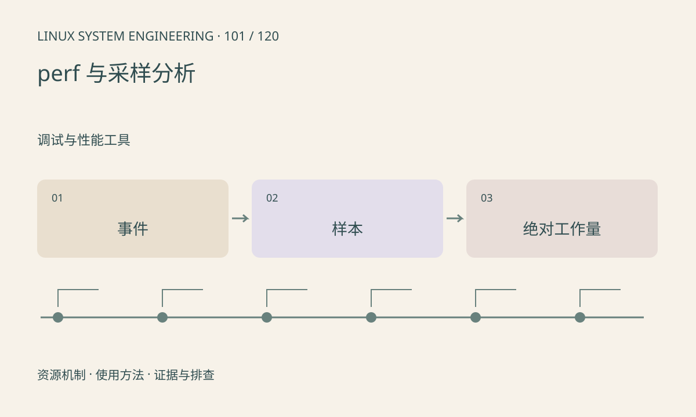

> 第 101 / 120 课 · 调试与性能工具。返回[课程合集](/series/embedded-linux-system-engineering/)。

## 机制与资源关系

perf 可读取性能事件并采样调用栈，但事件支持取决于 PMU、内核和权限。CPU 采样主要覆盖正在执行的时间，等待设备的线程可能样本很少。采样频率和展开方式也影响结果。



## 实际用法与观察入口

以下是操作说明；先确认执行环境、工具帮助和目标对象。设备名、PID、地址及项目名示例需要按实际替换，不能将整段命令当通用板端脚本执行。

```sh
perf --version
perf list
cat /proc/sys/kernel/perf_event_paranoid
# 测试环境对自有程序进行有界统计
sh build-debug.sh
perf stat -- ./demo
```

## 输出解读与排查顺序

先明确问题是 CPU 执行慢还是等待久，再选事件。计数复用、符号缺失、内联和帧指针都会影响解释；热点比例下降不一定意味着绝对时间下降。

### 情境推演

一个函数占比从 50% 降到 25%，也可能是其他部分变慢导致总时间翻倍。必须同时记录总耗时、输入规模和样本条件，才能声称优化成功。

## 练习与参考分析

比较两个固定工作量版本的总时长和 CPU 事件。参考结论：样本占比是相对值，必须同时记录业务量和绝对耗时。

### 独立实验包

主机有界 CPU 工作负载，验证确定性结果；perf 权限与硬件事件未自动测试。

```experiment
practice
```

## 官方资料与版本边界

- [本课参考资料](https://man7.org/linux/man-pages/man1/perf-stat.1.html)

内核、工具和厂商 BSP 的支持范围需分别核对。参考资料可能对应较新版本；不要据此推定旧 BSP 支持所有接口。

[上一课：ASan、UBSan 与内存错误](/posts/linux-sys-100.html) · [下一课：ftrace、tracepoints 与时序](/posts/linux-sys-102.html)
