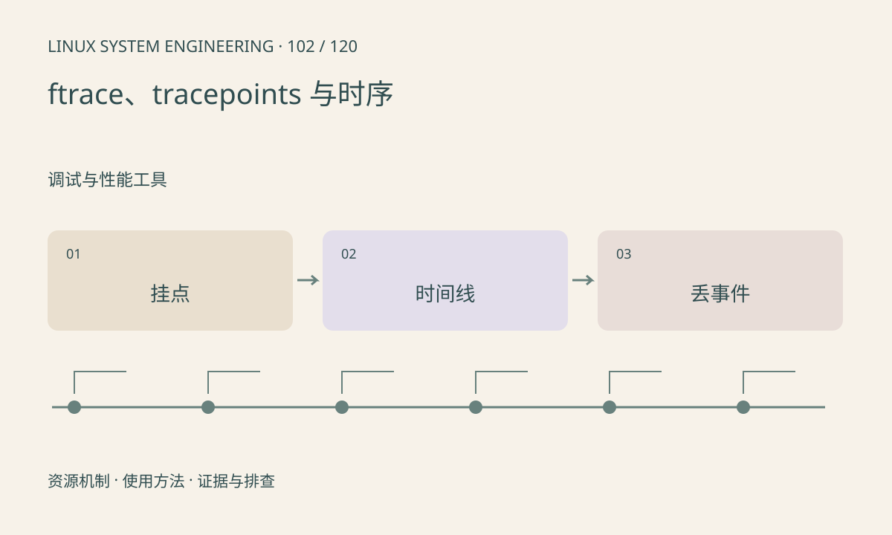

> 第 102 / 120 课 · 调试与性能工具。返回[课程合集](/series/embedded-linux-system-engineering/)。

## 机制与资源关系

静态 tracepoint 记录内核定义的事件，函数追踪观察调用行为。使用小范围事件、限定窗口和适当缓冲，可以降低开销并保留时序。trace_pipe 消费数据，多个读者可能互相影响。



## 实际用法与观察入口

以下是操作说明；先确认执行环境、工具帮助和目标对象。设备名、PID、地址及项目名示例需要按实际替换，不能将整段命令当通用板端脚本执行。

```sh
# 已有 tracefs 且允许读取时
cat /sys/kernel/tracing/available_tracers
cat /sys/kernel/tracing/available_events
cat /sys/kernel/tracing/trace_clock
```

## 输出解读与排查顺序

先确认事件、时间源、缓冲和丢失统计。开启追踪会修改系统状态，应在测试窗口保存原配置并恢复；本课默认只枚举能力，不自动启用全函数追踪。

### 情境推演

两条 sched_switch 之间相隔很久，不代表目标线程一直等待；期间可能主动睡眠或遗漏事件。关联 wakeup、状态、TID 和 CPU，并检查缓冲丢失统计。

## 练习与参考分析

设计 sched_wakeup→sched_switch 的配对规则，考虑多次唤醒和 CPU 迁移。参考结论：不能只按相邻两行相减，必须按任务和事件语义关联。

本课练习属于阅读、分析或板端观察。未在目标开发板执行，记录时应写明板型、内核配置、工具版本和原始输出。

## 官方资料与版本边界

- [本课参考资料](https://docs.kernel.org/trace/events.html)

内核、工具和厂商 BSP 的支持范围需分别核对。参考资料可能对应较新版本；不要据此推定旧 BSP 支持所有接口。

[上一课：perf 与采样分析](/posts/linux-sys-101.html) · [下一课：eBPF 的用途、条件与替代方案](/posts/linux-sys-103.html)
