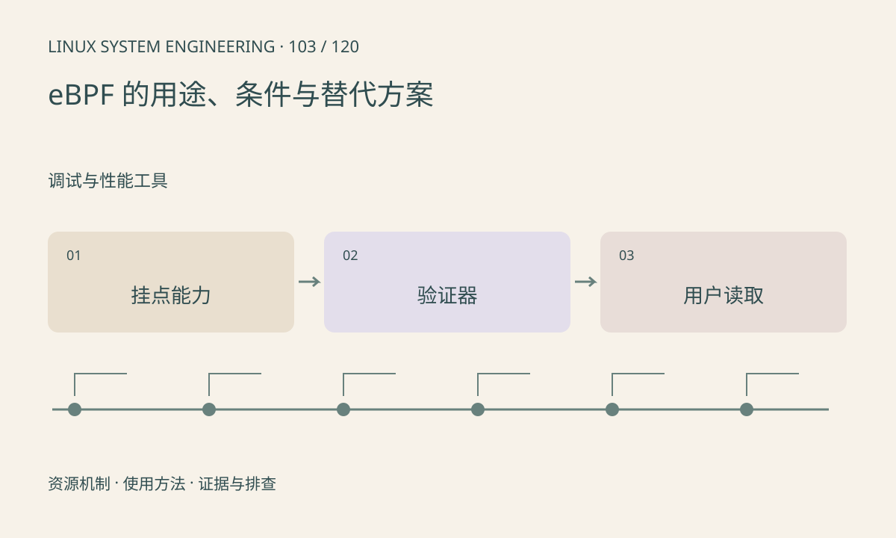

> 第 103 / 120 课 · 调试与性能工具。返回[课程合集](/series/embedded-linux-system-engineering/)。

## 机制与资源关系

eBPF 可在受控内核挂点运行经验证的程序，采集事件并通过 map 等传递结果。BTF、helper、程序类型和工具链支持因内核而异；CO-RE 也不是对所有旧 BSP 的兼容保证。



## 实际用法与观察入口

以下是操作说明；先确认执行环境、工具帮助和目标对象。设备名、PID、地址及项目名示例需要按实际替换，不能将整段命令当通用板端脚本执行。

```sh
command -v bpftool
ls /sys/kernel/btf
# 工具存在且允许时查询已加载对象
bpftool prog show
```

## 输出解读与排查顺序

加载失败需区分权限、验证器拒绝和内核缺能力。旧 BSP 可以先用 tracepoint、ftrace、perf 或用户态时间戳，不必为一次排障强行升级整套内核。

### 情境推演

BPF 程序加载失败并提示 helper 不支持，换用户态工具版本不一定补齐内核能力。应核对目标内核支持矩阵，选择可用 tracepoint 或应用埋点作为替代。

## 练习与参考分析

为“统计请求延迟”列出 BPF 和应用埋点两种设计及盲区。参考结论：观测点必须覆盖开始和结束，工具名称本身不能保证测到端到端时间。

本课练习属于阅读、分析或板端观察。未在目标开发板执行，记录时应写明板型、内核配置、工具版本和原始输出。

## 官方资料与版本边界

- [本课参考资料](https://docs.kernel.org/bpf/index.html)

内核、工具和厂商 BSP 的支持范围需分别核对。参考资料可能对应较新版本；不要据此推定旧 BSP 支持所有接口。

[上一课：ftrace、tracepoints 与时序](/posts/linux-sys-102.html) · [下一课：联合定位性能瓶颈](/posts/linux-sys-104.html)
