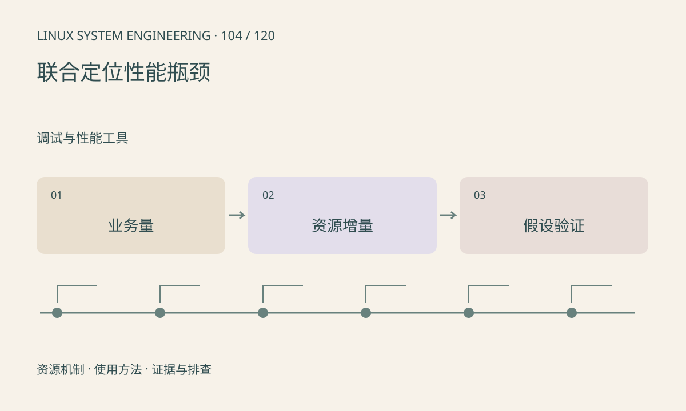

> 第 104 / 120 课 · 调试与性能工具。返回[课程合集](/series/embedded-linux-system-engineering/)。

## 机制与资源关系

性能是工作量、资源供给和排队共同作用的结果。优化单个函数可能让瓶颈转移到内存或 I/O；平均帧率也可能掩盖尾延迟。需要同时定义吞吐、延迟、峰值内存和功耗条件。



## 实际用法与观察入口

以下是操作说明；先确认执行环境、工具帮助和目标对象。设备名、PID、地址及项目名示例需要按实际替换，不能将整段命令当通用板端脚本执行。

```sh
cat /proc/stat
cat /proc/meminfo
cat /proc/diskstats
cat /proc/net/dev
```

## 输出解读与排查顺序

在同一窗口记录业务量和资源增量，先提出可证伪假设，再只改变一个变量。避免同时调优线程数、频率和缓冲，导致无法归因。

### 情境推演

减少图像拷贝后 CPU 降低但帧率不变，可能转为 NPU 或传感器帧率限制。继续看端到端延迟和功耗，不能因为吞吐未变就认定修改无效，也不能夸大收益。

## 练习与参考分析

使用本课构造时序计算排队、计算和结果年龄。参考结论：计算 10ms、排队 200ms 的请求，优先优化排队策略，而不是追求计算再快 1ms。

### 独立实验包

Python 3.10+ 标准库；构造时间线，不代表网络或 NPU 实测。 默认入口、源文件和实际运行记录都在下载包中。

```experiment
practice
```

## 官方资料与版本边界

- [本课参考资料](https://docs.kernel.org/admin-guide/psi.html)

内核、工具和厂商 BSP 的支持范围需分别核对。参考资料可能对应较新版本；不要据此推定旧 BSP 支持所有接口。

[上一课：eBPF 的用途、条件与替代方案](/posts/linux-sys-103.html) · [下一课：Oops、panic 与内核调用栈](/posts/linux-sys-105.html)
