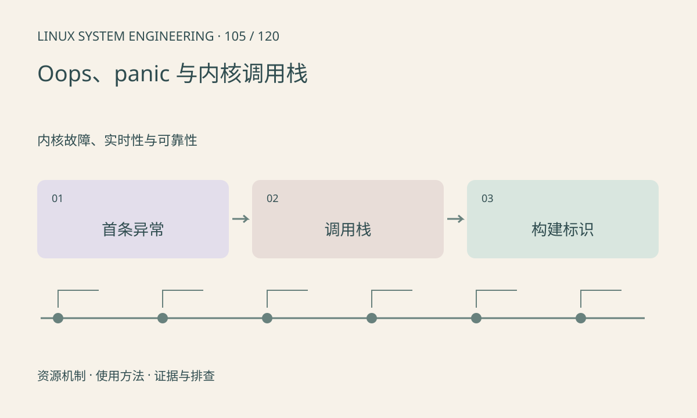

> 第 105 / 120 课 · 内核故障、实时性与可靠性。返回[课程合集](/series/embedded-linux-system-engineering/)。

## 机制与资源关系

Oops 报告内核异常，后续行为取决于上下文和策略；panic 则进入不可继续正常运行的处理路径。首条异常的寄存器、PC/LR、调用栈、模块及 taint 信息都很重要。



## 实际用法与观察入口

以下是操作说明；先确认执行环境、工具帮助和目标对象。设备名、PID、地址及项目名示例需要按实际替换，不能将整段命令当通用板端脚本执行。

```sh
dmesg
cat /proc/sys/kernel/tainted
ls /sys/fs/pstore
```

## 输出解读与排查顺序

先保存原始日志和精确 vmlinux/模块符号，不要仅摘最后几行。地址解析要考虑模块重定位和配置。内存破坏可能早于报错位置，应结合最近变更和受控复现。

### 情境推演

连续打印多个 Oops 时，后续栈可能已被第一次错误污染。优先保存首错前后的完整窗口，记录 taint 和模块，再用同版符号定位；不要只复制最后一次 panic。

## 练习与参考分析

把一份脱敏崩溃报告拆成环境、首错、栈和前置事件。参考结论：看到某模块在栈中不自动证明它是根因，需要数据流和生命周期证据。

本课练习属于阅读、分析或板端观察。未在目标开发板执行，记录时应写明板型、内核配置、工具版本和原始输出。

## 官方资料与版本边界

- [本课参考资料](https://docs.kernel.org/admin-guide/bug-hunting.html)

内核、工具和厂商 BSP 的支持范围需分别核对。参考资料可能对应较新版本；不要据此推定旧 BSP 支持所有接口。

[上一课：联合定位性能瓶颈](/posts/linux-sys-104.html) · [下一课：hung task、soft lockup 与 hard lockup](/posts/linux-sys-106.html)
