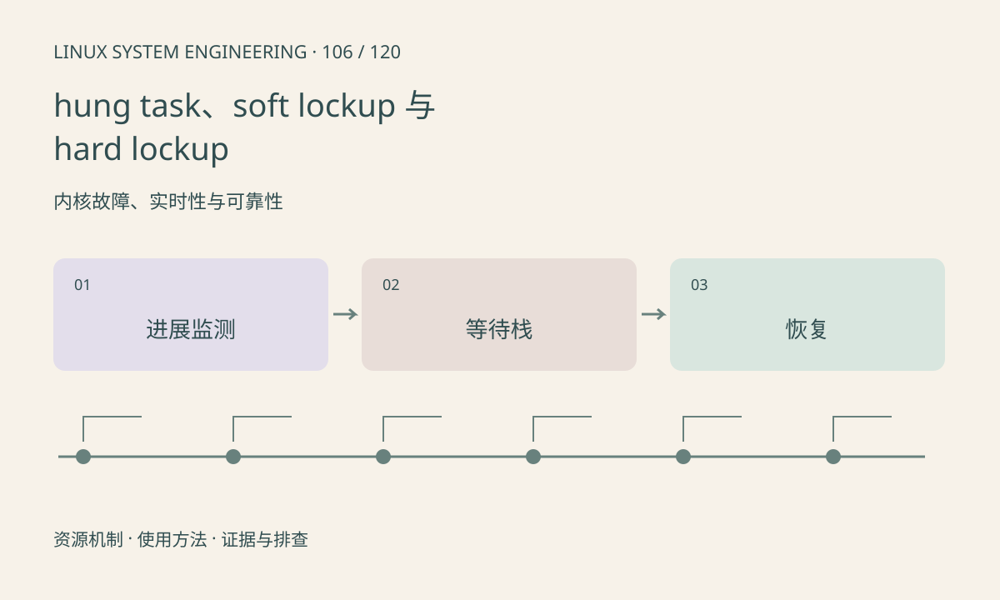

> 第 106 / 120 课 · 内核故障、实时性与可靠性。返回[课程合集](/series/embedded-linux-system-engineering/)。

## 机制与资源关系

hung task 常报告长时间不可中断等待；soft lockup 和 hard lockup 监测不同层次的 CPU 进展。具体实现、阈值和支持取决于架构与配置，不能只按名字判断故障严重程度。



## 实际用法与观察入口

以下是操作说明；先确认执行环境、工具帮助和目标对象。设备名、PID、地址及项目名示例需要按实际替换，不能将整段命令当通用板端脚本执行。

```sh
cat /proc/sys/kernel/hung_task_timeout_secs
cat /proc/sys/kernel/watchdog_thresh
dmesg
```

## 输出解读与排查顺序

字段不存在先查配置。保存受影响 CPU、任务栈及 IRQ 状态，区分锁等待、长关中断和设备不完成。调大超时只能改变报警，不等于修复根因。

### 情境推演

hung task 报告某线程等设备完成，真正原因可能是之前的 IRQ 丢失。需要把中断、任务提交和完成时序连接起来；把 hung_task_timeout_secs 调大只是延后报警。

## 练习与参考分析

给“所有线程正常但一个设备任务 D 状态”和“CPU 不再响应中断”分别列证据。参考结论：两者需要不同观察手段，不能统一靠重启服务解决。

本课练习属于阅读、分析或板端观察。未在目标开发板执行，记录时应写明板型、内核配置、工具版本和原始输出。

## 官方资料与版本边界

- [本课参考资料](https://docs.kernel.org/admin-guide/lockup-watchdogs.html)

内核、工具和厂商 BSP 的支持范围需分别核对。参考资料可能对应较新版本；不要据此推定旧 BSP 支持所有接口。

[上一课：Oops、panic 与内核调用栈](/posts/linux-sys-105.html) · [下一课：锁检查与内核调试配置](/posts/linux-sys-107.html)
