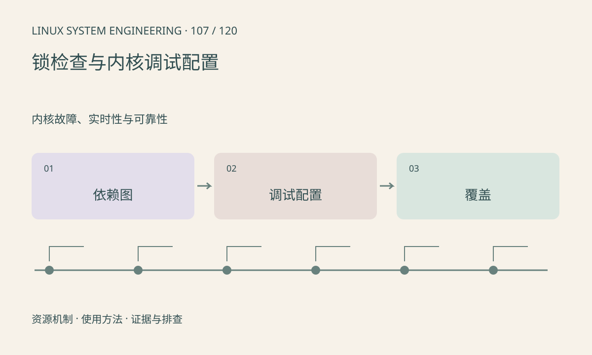

> 第 107 / 120 课 · 内核故障、实时性与可靠性。返回[课程合集](/series/embedded-linux-system-engineering/)。

## 机制与资源关系

lockdep 检查锁依赖及上下文规则，KASAN 等工具辅助检测内核内存错误。调试配置增加内存和执行开销，部分只适用于测试固件。没有报警不代表路径已被覆盖。



## 实际用法与观察入口

以下是操作说明；先确认执行环境、工具帮助和目标对象。设备名、PID、地址及项目名示例需要按实际替换，不能将整段命令当通用板端脚本执行。

```sh
# 配置导出可用时只读检查
zcat /proc/config.gz
cat /proc/sys/kernel/tainted
dmesg
```

## 输出解读与排查顺序

先固定可复现输入，再启用与假设相关的调试能力。驱动错误路径、并发 remove、超时取消是重点。内核调试产物要与正式性能基线分开保存。

### 情境推演

lockdep 报告 A→B 与 B→A 的潜在环，即使测试尚未死锁也值得修复。统一锁顺序后还要复测错误路径和中断上下文，不能仅压制警告。

## 练习与参考分析

画 A→B 和 B→A 两条加锁路径，说明潜在环。参考结论：单线程测试无法覆盖交错执行，需设计并发、取消和资源失败场景。

本课练习属于阅读、分析或板端观察。未在目标开发板执行，记录时应写明板型、内核配置、工具版本和原始输出。

## 官方资料与版本边界

- [本课参考资料](https://docs.kernel.org/locking/lockdep-design.html)

内核、工具和厂商 BSP 的支持范围需分别核对。参考资料可能对应较新版本；不要据此推定旧 BSP 支持所有接口。

[上一课：hung task、soft lockup 与 hard lockup](/posts/linux-sys-106.html) · [下一课：PREEMPT_RT 与实时延迟](/posts/linux-sys-108.html)
