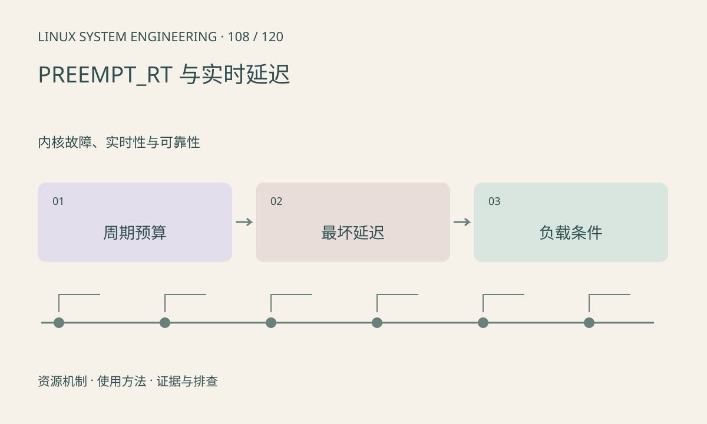

> 第 108 / 120 课 · 内核故障、实时性与可靠性。返回[课程合集](/series/embedded-linux-system-engineering/)。

## 机制与资源关系

实时性关注截止时间和最坏延迟。PREEMPT_RT 改变若干锁和中断执行方式，但不能消除固件、硬件、驱动和应用自身的无界阻塞。普通平均 CPU 使用率不能证明实时目标达成。



## 实际用法与观察入口

以下是操作说明；先确认执行环境、工具帮助和目标对象。设备名、PID、地址及项目名示例需要按实际替换，不能将整段命令当通用板端脚本执行。

```sh
uname -a
cat /sys/kernel/realtime
cat /proc/interrupts
# 节点缺失时检查构建配置，不据此单独下结论
```

## 输出解读与排查顺序

在代表性负载下测延迟分布和最大值，并记录频率、温度、IRQ 和优先级。cyclictest 等工具的设置会影响负载，应在专用测试窗口运行。

### 情境推演

空闲时延迟很好而高 I/O 时超期，需要在真实竞争负载下观察关中断、锁和调度。实时验收应给出测试时长和异常次数，有限测试不能证明所有未来情形都满足。

## 练习与参考分析

为 5ms 控制周期分配计算、等待和抖动预算。参考结论：若某次阻塞可达 20ms，切换 RT 内核不能自动满足截止时间，需修改阻塞协议。

本课练习属于阅读、分析或板端观察。未在目标开发板执行，记录时应写明板型、内核配置、工具版本和原始输出。

## 官方资料与版本边界

- [本课参考资料](https://docs.kernel.org/core-api/real-time/index.html)

内核、工具和厂商 BSP 的支持范围需分别核对。参考资料可能对应较新版本；不要据此推定旧 BSP 支持所有接口。

[上一课：锁检查与内核调试配置](/posts/linux-sys-107.html) · [下一课：时钟源、时间戳与对齐](/posts/linux-sys-109.html)
