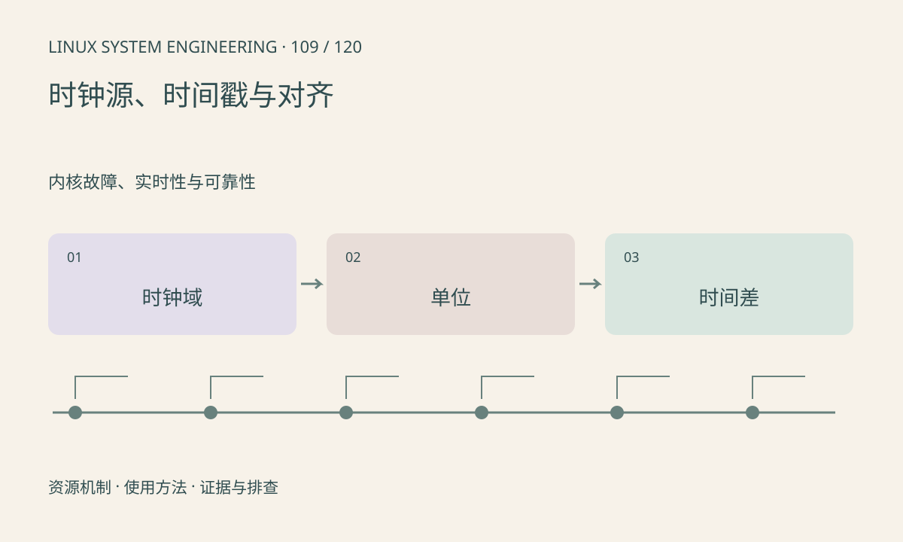

> 第 109 / 120 课 · 内核故障、实时性与可靠性。返回[课程合集](/series/embedded-linux-system-engineering/)。

## 机制与资源关系

CLOCK_REALTIME 表示墙上时间，可能被校准；CLOCK_MONOTONIC 适合测量同系统的持续时间。不同设备或远端主机的时间戳可能来自独立时钟，不能直接相减。挂起时间是否计入也需选择相应时钟。



## 实际用法与观察入口

以下是操作说明；先确认执行环境、工具帮助和目标对象。设备名、PID、地址及项目名示例需要按实际替换，不能将整段命令当通用板端脚本执行。

```sh
cat /sys/devices/system/clocksource/clocksource0/current_clocksource
cat /sys/devices/system/clocksource/clocksource0/available_clocksource
cat /proc/uptime
```

## 输出解读与排查顺序

每条时间戳标明单位、时钟域和采样位置。毫秒/微秒混用会造成千倍错误；设备计数器回绕需要展开。同步误差应作为延迟结果的不确定性记录。

### 情境推演

sensor 时间戳是微秒、应用日志是毫秒，直接相减会产生巨大伪延迟。先统一单位并确认基准；跨板时间差还包含同步误差，报告必须注明。

## 练习与参考分析

运行单调时钟测量示例。参考结论：请求 sleep 10ms 不保证恰好 10ms 后执行，只能在测量后报告实际耗时，不能硬编码成性能结论。

### 独立实验包

主机 Linux 的有界 C 实验；不访问真实外设，不代表板端时序或性能。 默认入口、源文件和实际运行记录都在下载包中。

```experiment
practice
```

## 官方资料与版本边界

- [本课参考资料](https://man7.org/linux/man-pages/man2/clock_gettime.2.html)

内核、工具和厂商 BSP 的支持范围需分别核对。参考资料可能对应较新版本；不要据此推定旧 BSP 支持所有接口。

[上一课：PREEMPT_RT 与实时延迟](/posts/linux-sys-108.html) · [下一课：频率、温度与降频](/posts/linux-sys-110.html)
